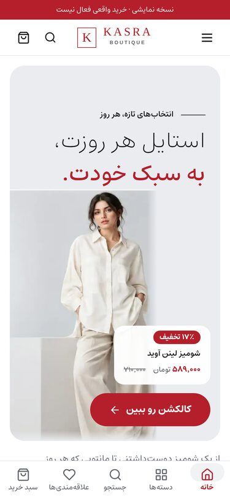
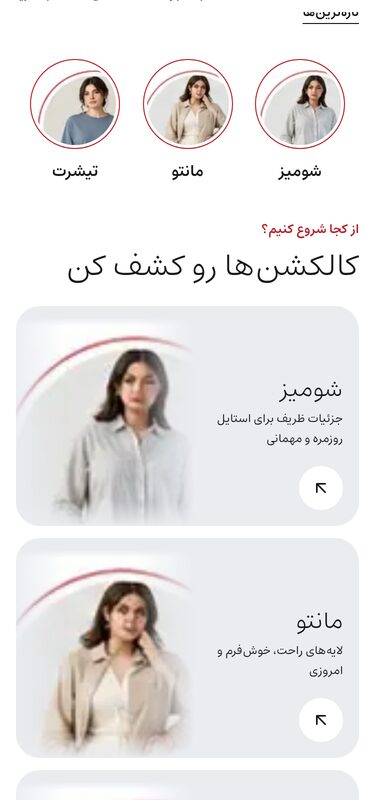
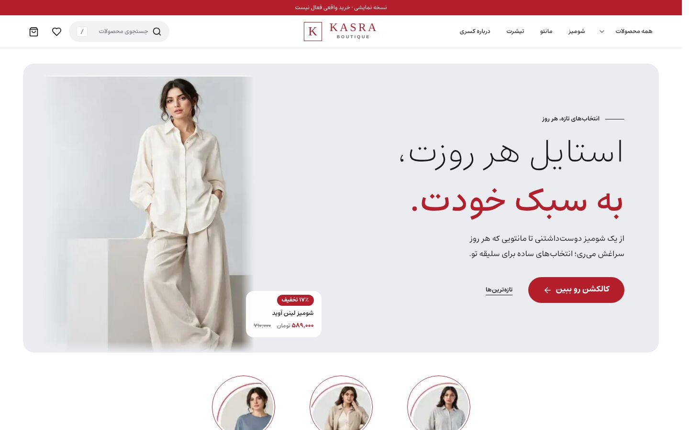
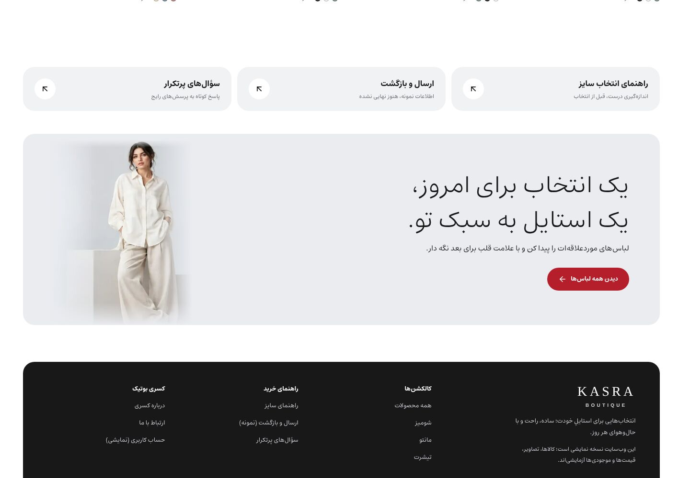

# بررسی صفحه‌ی اصلی کسری بوتیک — مرحله ۱

> **وضعیت:** فقط بررسی. هیچ خطی از کد تغییر نکرده. برای شروع مرحله ۲ منتظر تأیید شما هستیم.
> تصمیم‌هایی که لازم است شما بگیرید در [بخش ۸](#۸-تصمیمهایی-که-از-شما-لازم-است) آمده است.

| | |
|---|---|
| **پایه‌ی بررسی** | شاخه‌ی `claude/zen-ride-0syp1s`، کامیت `a399aa5` (Palette B) |
| **روش اجرا** | بیلد production (`next build` و `next start`) در حالت دمو (بدون بک‌اند، ۳۶ محصول نمونه) |
| **مرورگر** | Chromium با Playwright، عرض‌های ۳۷۵ / ۷۶۸ / ۱۲۸۰ / ۱۴۴۰ پیکسل. موبایل با لمس و DPR=2. همه‌ی تصاویر lazy با اسکرول کامل لود شدند |
| **ابزارها** | axe-core (WCAG 2.2 AA)، اندازه‌گیری LCP و CLS با شبکه‌ی کند (۱.۶ مگابیت، ۱۵۰ms) و CPU چهار برابر کندتر، بررسی ابعاد واقعی تصاویر |
| **اسکرین‌شات‌ها** | `docs/homepage-audit/before/` (فهرست در پیوست) |

---

## خلاصه

1. **پایه‌ی فنی پروژه خوب است.** توکن‌های طراحی، RTL با logical properties، صفر خطای axe، CLS نزدیک صفر، تصویر هیرو با اولویت بالا و فونت فارسی self-host. این‌ها را نگه می‌داریم.
2. **عکس‌ها مهم‌ترین مشکل‌اند.** کارت‌های محصول، کاشی‌های دسته‌بندی و دایره‌ها از برش‌های **۹۴×۹۴ پیکسلی** ماکاپ ساخته شده‌اند که تا **۴.۵ برابر** بزرگ نمایش داده می‌شوند. حلقه‌ی قرمز ماکاپ هم داخل خود عکس مانده و روی کارت‌ها به‌صورت کمان‌های قرمز دیده می‌شود. در صفحه‌ای که ستاره‌اش باید عکس باشد، این کیفیت حس «برند» را از بین می‌برد.
3. **رنگ قرمز برند با هدف «شیک و آرام» نمی‌خواند.** قرمز `#B51F2B` روی نوار اعلان، لوگو، همه‌ی دکمه‌ها، برچسب تخفیف، قیمت حراج، تیتر کوچک بالای هر بخش و شمارنده‌ها نشسته است. نتیجه حال‌وهوای «حراج» است، نه «بوتیک».
4. **در موبایل خیلی دیر به محصول می‌رسیم.** اولین کارت محصول در **۲۲۰۴ پیکسلی** صفحه است، یعنی حدود سه صفحه اسکرول. دسته‌بندی‌ها دو بار پشت سر هم تکرار می‌شوند و هیچ اسکرول افقی‌ای وجود ندارد.
5. **صفحه نفس نمی‌کشد.** تقریباً هر بخش داخل یک جعبه‌ی گرد طوسی است (۱۱ پنل بزرگ گرد در موبایل).
6. **بخش‌های اصلی فروش وجود ندارند:** پرفروش‌ها، پیشنهاد ویژه، اعتمادسازی با محتوای واقعی، خبرنامه، اینستاگرام، و اطلاعات تماس و نماد اعتماد در فوتر.
7. **یک باگ در حالت production:** بخش «منتخب کسری» از اسلاگ‌های ثابت دمو ساخته می‌شود. با بک‌اند واقعی، این بخش **با تیتر ولی بدون هیچ محصولی** نمایش داده می‌شود.

### اعداد پایه (قبل از تغییر)

| معیار | ۳۷۵ | ۷۶۸ | ۱۲۸۰ | ۱۴۴۰ |
|---|---|---|---|---|
| ارتفاع کل صفحه (px) | ۷۱۱۱ | ۸۲۵۰ | ۵۷۷۱ | ۶۱۰۴ |
| ارتفاع هیرو (px) | ۸۹۵ (صفحه‌نمایش ۸۱۲ است) | ۹۹۵ | ۷۸۶ | ۸۵۶ |
| فاصله‌ی اولین کارت محصول از بالای صفحه (px) | **۲۲۰۴** | ۲۴۴۳ | ۱۸۶۸ | ۱۹۹۵ |
| پنل‌های بزرگ گرد با پس‌زمینه | ۱۱ | ۷ | ۱۰ | ۱۰ |
| اسکرول افقی ناخواسته | ندارد | ندارد | ندارد | ندارد |
| خطای axe (WCAG 2.2 AA) | ۰ | — | — | ۰ |

- **سرعت (موبایل، شبکه‌ی کند شبیه‌سازی‌شده):** LCP حدود ۱.۵ ثانیه، CLS برابر ۰.۰۰۰۸، حجم دانلود ۳۶۸KB. عنصر LCP عکس هیروست که درست است. (عدد Lighthouse ثبت‌شده در `DESIGN.md`: LCP ۳.۰۵ ثانیه، امتیاز ۹۴.)
- **تکرار عکس:** از ۲۹ تصویر صفحه، عکس `hero-model` **۱۰ بار** تکرار شده است. کلمه‌ی «انتخاب» ۱۱ بار و «تخفیف» ۵ بار در متن صفحه آمده است.

### ابعاد واقعی تصاویر در مقایسه با اندازه‌ی نمایش

| فایل | ابعاد واقعی | محل نمایش در ۱۴۴۰ | بزرگ‌نمایی |
|---|---|---|---|
| `public/images/brand-preview/{shomiz-blue,manto-cream,manto-pink,shomiz-cream,tshirt-blue}.avif` | ۹۴×۹۴ | کارت محصول ۳۲۰×۴۲۷ | **۴.۵ برابر**، و برش مربع داخل قاب ۳:۴ |
| همان فایل‌ها | ۹۴×۹۴ | کاشی دسته‌بندی ۲۶۸×۴۰۶ | **۴.۳ برابر** |
| `brand-preview/hero-model.avif` | ۴۵۸×۵۹۷ | هیرو ۴۴۵×۵۸۱ | در دسکتاپ قابل قبول است. در موبایل با DPR=2 حدود ۱.۴ برابر |
| `public/images/lookbook/*.avif` (۶ فایل، در صفحه‌ی اصلی استفاده نشده) | ۴۸۰×۶۴۰ | — | **نسبت ۳:۴ درست، پس‌زمینه‌ی گرم یکدست، یک مدل ثابت** |

---

## تکنولوژی و ساختار

- **فریم‌ورک:** Next.js 16 (App Router)، React 19 و TypeScript strict. صفحه‌ی اصلی `src/app/page.tsx` یک Server Component با `dynamic = 'force-dynamic'` است.
- **استایل‌دهی:** Tailwind 4 فقط به‌عنوان لایه‌ی `@theme` برای توکن‌ها استفاده شده است. استایل‌ها CSS خام با logical properties هستند که به این ترتیب لایه‌بندی شده‌اند:
  `src/styles/tokens.css → base.css → primitives.css → layout.css → home.css → catalog.css → …`
  کلاس utility تقریباً استفاده نمی‌شود.
- **فونت:** Estedad 8.5 variable، با زیرمجموعه‌ی فارسی ۸۱KB، از طریق `next/font/local` (`src/app/layout.tsx`). لوگوی لاتین با فونت سیستمی Georgia نوشته شده است.
- **آیکون:** `lucide-react`.
- **اجزای صفحه‌ی اصلی:**
  - `src/components/home/hero-slider.tsx`: اسلایدر هیرو. در حالت بک‌اند، محصولاتش را مدیر از پنل ادمین انتخاب می‌کند
  - `src/components/home/collection-circles.tsx`: دایره‌های دسته‌بندی
  - `src/components/home/shop-by-color.tsx`: خرید بر اساس رنگ (Client)
  - `src/components/products/product-grid.tsx`، `product-card.tsx`، `price.tsx`، `wishlist-button.tsx`
  - مشترک: `src/components/layout/header.tsx`، `header-actions.tsx`، `primary-nav.tsx`، `mobile-menu.tsx`، `bottom-nav.tsx`، `footer.tsx`، `src/components/search/search-launcher.tsx`
- **داده:** `getCatalogProducts` و `getHomeSlides` در `src/lib/backend-products.ts`. در حالت دمو از `src/data/products.ts` و `src/data/facets.ts` خوانده می‌شود و در حالت واقعی از API بک‌اند (Fastify).
- **تست‌ها:** Playwright در `tests/`. فایل `tests/storefront-polish.spec.ts` رنگ‌های Palette B و عکس‌های ماکاپ را قفل کرده است، پس با تغییر آن‌ها باید به‌روز شود. تست axe در `tests/a11y.spec.ts` است.

---

## ۱. برداشت کلی از نگاه سه نقش

### طراح UI/UX
زبان طراحی «مجله‌ی کسری» ایده‌ی درستی دارد: تیتر Estedad با وزن خیلی سبک، شماره‌گذاری ادیتوریال و یک مدل ثابت. اما سه چیز آن را از سطح یک برند مد پایین می‌آورد:

- **عکس‌های بی‌کیفیت** که حلقه‌ی ماکاپ رویشان مانده.
- **قرمز پررنگ** روی همه‌ی نقاط تأکید.
- **«جعبه‌ی گرد طوسی» برای همه‌چیز:** هیرو، رنگ‌ها، بنر ادیتوریال، لینک‌های خدمات، CTA پایانی و حتی فوتر.

برندهای مد ادیتوریال، صفحه را با **فضای سفید، خط‌های نازک و عکس بزرگ** می‌سازند، نه با کارت و باکس. الان چشم به‌جای لباس، روی قاب‌ها و رنگ قرمز می‌نشیند. سلسله‌مراتب متنی هم شلوغ است: هر بخش یک تیتر کوچک قرمز، یک تیتر بزرگ سبک و یک زیرتیتر دارد، و متن‌ها تکراری‌اند («انتخاب» ۱۱ بار).

### توسعه‌دهنده‌ی فرانت‌اند
کیفیت کد بالاست: توکن‌محور، RTL منطقی، `dialog` بومی، ۴۴ پیکسل برای هدف‌های لمسی، `prefers-reduced-motion` سراسری، LCP بدون انیمیشن و CLS صفر. ایرادها از این نوع‌اند:

- **داده و دارایی:** عکس ۹۴ پیکسلی و اسلاگ‌های ثابت دمو که در production خالی می‌شوند.
- **سرعت در حالت بک‌اند:** صفحه‌ی اصلی در هر درخواست، بدون کش، تا ۱۰ درخواست پشت‌سرهم به API می‌زند و کل کاتالوگ را می‌گیرد.
- **ریسپانسیو:** در عرض ۶۰۱ تا ۸۲۰ پیکسل گرید دوستونه با کارت‌های ۳۴۰ پیکسلی داریم، و در موبایل هیچ اسکرول افقی‌ای نیست.
- **جزئیات:** چند مقدار hardcode، مدت انیمیشن‌های طولانی‌تر از ۳۰۰ میلی‌ثانیه، لوگوی وابسته به فونت سیستمی (در اندروید، Georgia وجود ندارد و لوگو با Noto Serif نمایش داده می‌شود)، و تحویل عکس فقط با WebP (بدون AVIF).

### متخصص فروش و تجارت الکترونیک
خریدار زن ایرانی معمولاً با موبایل و از اینستاگرام وارد می‌شود. در ۵ ثانیه‌ی اول می‌خواهد سه چیز را بفهمد: «چی دارید؟»، «کیفیتش چطوره؟» و «اگه اندازه نشد چی؟». صفحه‌ی فعلی:

- در صفحه‌نمایش اول **فقط یک محصول** نشان می‌دهد. دسته‌بندی‌ها زیر خط اول صفحه‌اند.
- عکس‌های تار، **اعتماد به کیفیت لباس** را از بین می‌برند. این بزرگ‌ترین مانع تبدیل است.
- قرمزِ همه‌جا و برچسب «۱۷٪ تخفیف» قرمز روی عکس، برند را **ارزان** نشان می‌دهد، در حالی که مخاطب این برند دنبال کیفیت است.
- **هیچ پاسخی به نگرانی اندازه و مرجوعی** (مهم‌ترین مانع خرید لباس آنلاین در ایران) در خود صفحه نیست. فقط یک لینک ساده با برچسب «اطلاعات نمونه، هنوز نهایی نشده» هست.
- خبرنامه، باشگاه مشتریان پیامکی، لینک اینستاگرام، نماد اعتماد و شماره‌ی تماس وجود ندارد. در بازار ایران، **اینماد و شماره‌ی تماس** پیش‌شرط اعتماد به هر فروشگاه تازه است.

---

## ۲. چیزهایی که خوب است و باید بماند

- معماری توکن‌ها (`src/styles/tokens.css`) و RTL کامل با logical properties.
- دسترس‌پذیری: صفر خطای axe، skip link، focus قابل دیدن، `aria-live` برای سبد خرید، کنترل توقف اسلایدر (WCAG 2.2.2)، هدف‌های لمسی ۴۴ پیکسل در موبایل (هیچ هدف کوچکی در ۳۷۵ پیدا نشد).
- سرعت: تصویر هیرو با `preload` و `fetchPriority="high"`، لود lazy برای پایین صفحه، `sizes` برای تصاویر، CLS نزدیک صفر، فونت subset.
- اعداد فارسی با جداکننده‌ی هزارگان و «تومان». قیمت قبلی خط‌خورده و کم‌رنگ است.
- کارت محصول: نسبت ۳:۴، قلب ۴۴ پیکسلی روی عکس، دایره‌های رنگ، سوایپ بین دو عکس در موبایل و جابه‌جایی عکس با hover در دسکتاپ.
- اسلایدر هیرو که از پنل مدیریت کنترل می‌شود (این قابلیت را حفظ می‌کنیم).
- هدر sticky، جستجو با میان‌بر `/`، منوی تمام‌صفحه‌ی موبایل با بستن از طریق سوایپ، و ناوبری پایین صفحه در موبایل.
- صداقت دمو: هیچ نظر جعلی، شمارنده‌ی کمبود موجودی یا ادعای ساختگی‌ای در صفحه نیست. این را حفظ می‌کنیم.

---

## ۳. فهرست مشکلات

> شماره‌ی خط‌ها مربوط به کامیت `a399aa5` است.

### Critical

| # | مشکل | محل در کد | راه‌حل |
|---|---|---|---|
| **C1** | **عکس کارت‌ها و دسته‌بندی‌ها تار و معیوب است.** برش‌های ۹۴×۹۴ پیکسلی ماکاپ ۴.۳ تا ۴.۵ برابر بزرگ شده و به‌زور در قاب ۳:۴ قرار گرفته‌اند. حلقه‌ی قرمز ماکاپ داخل عکس مانده: روی هر کاشی و کارت یک کمان قرمز دیده می‌شود، کارت «مانتو لینن ارغوان» عملاً یک دایره‌ی بزرگ‌شده است، و دایره‌های دسته‌بندی دو حلقه دارند (حلقه‌ی CSS به‌علاوه‌ی حلقه‌ی داخل عکس). در hover دسکتاپ، عکس دوم که تارتر است جای عکس اول را می‌گیرد. | `src/data/products.ts:9-20` (`brandMockupPhotos` و `demoPhotos`) و `:72`؛ `src/components/home/collection-circles.tsx:7-11`؛ `src/app/page.tsx:69`؛ `src/styles/primitives.css:101-115` | **دمو:** استفاده از مجموعه‌ی `public/images/lookbook/` (۴۸۰×۶۴۰، نسبت ۳:۴، پس‌زمینه‌ی گرم یکدست، یک مدل ثابت) برای کارت‌ها، دسته‌بندی‌ها و ادیتوریال، و کنار گذاشتن برش‌های ۹۴ پیکسلی. **برای لانچ:** عکس واقعی هر محصول با حداقل ۱۶۰۰ پیکسل در ضلع بلند، نسبت ۳:۴، دو عکس برای هر محصول (روبه‌رو و جزئیات یا پشت) و پس‌زمینه‌ی ثابت. ⚠️ کامیت `a399aa5` این عکس‌ها را عمداً انتخاب کرده بود («عین ماکاپ»)، پس **تأیید شما لازم است.** |
| **C2** | **پالت قرمز با هدف «آرام و شیک» در تضاد است.** قرمز `#B51F2B` در این جاها استفاده شده: نوار اعلان، لوگو، لینک فعال منو، همه‌ی دکمه‌های اصلی، شمارنده‌ی سبد، تیترهای کوچک بالای بخش‌ها، کلمه‌ی تأکیدی تیتر هیرو، برچسب تخفیف، قیمت حراج و حلقه‌ی دایره‌ها. نتیجه این است که صفحه «حراجی» دیده می‌شود. پس‌زمینه‌ی طوسی سرد `#EAECF0` هم با عکس‌های گرم (پس‌زمینه‌ی حدود `#C8AC90`) هماهنگ نیست. | `src/styles/tokens.css:11-30`. محل‌های استفاده: `layout.css:3-4، 23، 25، 39`؛ `primitives.css:23، 71-77، 105`؛ `base.css:70-71`؛ `home.css:26، 87، 179`؛ `catalog.css:64، 105` | پالت خنثی‌ی گرم با دکمه‌های مشکی (ink) و **یک** رنگ تأکیدی ملایم که در هر صفحه‌نمایش حداکثر در ۲ یا ۳ جا استفاده شود ([بخش ۶](#۶-سیستم-طراحی-پیشنهادی)). ⚠️ Palette B را مالک در کامیت ۳ آبان ۱۴۰۵ تأیید کرده بود، پس **این تغییر به تأیید شما نیاز دارد.** تست‌های `tests/storefront-polish.spec.ts:31-43، 57-63، 90` و سند `docs/BRAND-PALETTE-B.md` هم باید به‌روز شوند. |

### High

| # | مشکل | محل در کد | راه‌حل |
|---|---|---|---|
| **H1** | **لبه‌ی تیز عکس هیرو دیده می‌شود.** ماسک بالای عکس محو نشده و پس‌زمینه‌ی عکس (آبی‌طوسی روشن با بلوک‌های سفید استودیو) با رنگ اتاق یکی نیست. در ۱۲۸۰ و ۱۴۴۰ لبه‌ی بالا و راست عکس به‌صورت یک مستطیل دیده می‌شود. در ۳۷۵ و ۷۶۸ یک خط افقی پشت تیتر می‌افتد. | `src/styles/home.css:64-80` (`.hero-figure-mockup`)، `:236` (`inset-block: 33% 0`) | عکس به‌صورت «قاب تمیز» با لبه‌ی مشخص نمایش داده شود (بدون محوسازی). در موبایل تمام‌عرض باشد و متن هرگز روی درز عکس نیفتد. |
| **H2** | **«جعبه برای همه‌چیز».** ۱۱ پنل بزرگ گرد با پس‌زمینه (radius ۲۴ پیکسل) داریم: هیرو، دسته‌بندی‌ها، رنگ‌ها، ادیتوریال، لینک‌های خدمات، CTA پایانی و فوتر. صفحه شبیه داشبورد اپلیکیشن شده و فضای سفید نفس نمی‌کشد. | `home.css:15، 107، 134، 165، 184، 194`؛ `layout.css:125` | بخش‌ها مستقیم روی زمینه‌ی کرم بنشینند و با فضای خالی (و در صورت نیاز یک خط نازک) از هم جدا شوند. فقط ۱ یا ۲ نوار رنگی تمام‌عرض بماند (ادیتوریال فصل و اعتماد یا خبرنامه). گوشه‌ی عکس‌ها ۰ تا ۴ پیکسل باشد. |
| **H3** | **ایرادهای mobile-first.** هیرو ۸۹۵ پیکسل است ولی صفحه‌نمایش ۸۱۲. دسته‌بندی‌ها دو بار پشت سر هم می‌آیند (اول دایره‌ها، بعد سه کاشی عمودی ۲۲۰ پیکسلی). همه‌ی بخش‌های محصول گرید ۲×۲ هستند و هیچ اسکرول افقی‌ای نیست. اولین محصول در ۲۲۰۴ پیکسلی است. | `home.css:220-236`؛ `page.tsx:58` (دایره‌ها) و `:63-76` (کاشی‌ها)؛ `catalog.css:267` | هیرو حداکثر حدود ۸۰٪ ارتفاع صفحه‌نمایش (با احتساب هدر) باشد تا ردیف دسته‌بندی‌ها از پایین صفحه‌ی اول پیدا باشد. دسته‌بندی فقط یک بار، به‌صورت ردیف افقی کارت‌های ۳:۴. بخش‌های محصول در موبایل اسکرول افقی با scroll-snap داشته باشند. |
| **H4** | **تکرار و شلوغی.** عکس `hero-model` ۱۰ بار در صفحه تکرار شده (هیرو، ادیتوریال، CTA پایانی و کارت‌ها). سه یادداشت دمو داخل صفحه هست، به‌علاوه‌ی نوار اعلان و فوتر. متن‌ها هم تکراری‌اند («انتخاب» ۱۱ بار). | `page.tsx:75، 90، 115`؛ `shop-by-color.tsx:61`؛ `products.ts:16-20` | فقط یک یادداشت صادقانه‌ی دمو (در نوار اعلان و فوتر). تنوع عکس از lookbook. بازنویسی متن‌ها. |
| **H5** | **باگ production: «منتخب کسری» خالی می‌شود.** اسلاگ‌های ثابت دمو (`manto-03` و …) در دیتابیس واقعی وجود ندارند، `filter(Boolean)` آرایه‌ی خالی برمی‌گرداند و بخش با تیتر ولی بدون محصول رندر می‌شود. | `src/app/page.tsx:44` | استفاده از فیلد `featured` (در نوع `Product` وجود دارد) با جایگزین «جدیدترین‌های غیرتکراری». هر بخشی که خالی است اصلاً رندر نشود. |
| **H6** | **بخش‌های اصلی فروش وجود ندارند:** پرفروش‌ها، پیشنهاد ویژه، اعتمادسازی با آیکون و محتوای واقعی، خبرنامه یا باشگاه پیامکی، اینستاگرام، و اطلاعات تماس، شبکه‌های اجتماعی و نماد در فوتر. | `page.tsx`، `footer.tsx` | جزئیات در [بخش ۴](#۴-چیزهایی-که-صفحه-کم-دارد) و [بخش ۵](#۵-ساختار-پیشنهادی-صفحه). |

### Medium

| # | مشکل | محل در کد | راه‌حل |
|---|---|---|---|
| **M1** | **تایپوگرافی.** ۷ وزن فونت (۲۰۰ تا ۸۰۰) استفاده شده. وزن ۲۰۰ در تیتر هیرو روی ویندوز با DPI پایین خیلی نازک دیده می‌شود. هر بخش سه لایه متن دارد (تیتر کوچک قرمز، H2 سبک و زیرتیتر). مقیاس اندازه‌ها با `clamp` پله‌های نامنظم دارد. | `tokens.css:43-68`؛ `base.css:70-79` | ۴ وزن (۳۰۰، ۴۰۰، ۵۰۰، ۷۰۰). مقیاس ثابت و منظم. حذف تیتر کوچک بالای بیشتر بخش‌ها. |
| **M2** | **لحن متن یکدست نیست.** مثلاً «کالکشن **رو** ببین» و «رنگ موردعلاقه‌ات رو انتخاب کن» (محاوره، خطاب «تو») کنار «لباس‌های موردعلاقه‌ات **را** پیدا کن» (نوشتاری) و «استایل به سبک **شما**» (خطاب «شما»). یا «سراغش می‌ری» در کنار متن رسمی. | `page.tsx:51-117`؛ `shop-by-color.tsx:20-22` | یک لحن واحد (پیشنهاد در بخش ۸) و متن‌های کوتاه‌تر و حساب‌شده‌تر. |
| **M3** | **نمایش تخفیف پرسروصداست.** برچسب قرمز توپر «۱۷٪ تخفیف» روی عکس، قیمت قرمز، و برچسب قرمز در تگ هیرو. | `catalog.css:59-65، 105`؛ `home.css:87` | برچسب کوچک کاغذی با متن رنگ تأکیدی («۱۷٪−»). قیمت فعلی مشکی و قیمت قبلی کم‌رنگ و خط‌خورده. |
| **M4** | **کارت محصول.** عکس دوم در hover تار است (به C1 برمی‌گردد). برچسب «جدید» وجود ندارد. عبارت «۳ رنگ» کنار دایره‌های رنگ تکراری است. در ردیف‌های افقی، ارتفاع بخش اطلاعات کارت‌ها یکسان نیست. | `src/components/products/product-card.tsx`؛ `catalog.css:23-112` | چیدن ردیف‌ها با CSS subgrid تا نام‌ها و قیمت‌ها در یک ردیف هم‌تراز شوند، بدون اینکه زیر نام‌های یک‌خطی جای خالی بماند. برچسب «جدید» بر اساس `createdAt`. برچسب «ناموجود» ظریف. |
| **M5** | **تبلت (۶۰۱ تا ۸۲۰ پیکسل).** گرید دوستونه با کارت‌های حدود ۳۴۰ پیکسلی و کاشی‌های تک‌ستونه، صفحه را به ۸۲۵۰ پیکسل رسانده است. | `catalog.css:266-267`؛ `home.css:215-219` | از ۶۰۰ پیکسل به بالا گرید سه‌ستونه. ردیف افقی برای دسته‌بندی‌ها. |
| **M6** | **هدر.** در اسکرول جمع‌وجور نمی‌شود. حساب کاربری در هدر دسکتاپ نیست. نوار اعلان قرمز است. لوگو به فونت سیستمی Georgia وابسته است، پس در اندروید (بیشتر کاربران ایرانی) با Noto Serif و شکل دیگری نمایش داده می‌شود. | `layout.css:3-7، 21-27`؛ `tokens.css:42`؛ `header-actions.tsx` | لوگوی SVG با **همان طرح فعلی**. آیکون حساب کاربری. حالت جمع‌وجور sticky فقط با CSS. نوار اعلان با رنگ خنثی. |
| **M7** | **انیمیشن‌ها طولانی‌تر از معیار ۱۵۰ تا ۳۰۰ میلی‌ثانیه‌اند.** زوم عکس کارت ۱۴۰۰، زوم کاشی ۱۲۰۰، خط زیر لینک ۴۰۰ تا ۵۰۰، پس‌زمینه‌ی منو و خدمات ۴۰۰، فلش ۵۰۰، cross-fade هیرو ۷۰۰، و رونمایی تیتر ۱۱۰۰ میلی‌ثانیه. | `catalog.css:36، 95`؛ `home.css:62-63، 90، 125، 186`؛ `layout.css:35`؛ `primitives.css:120` | تعامل‌های رابط کاربری ۱۵۰ تا ۲۵۰ میلی‌ثانیه، hover عکس ۳۰۰ میلی‌ثانیه، cross-fade هیرو حداکثر ۵۰۰ میلی‌ثانیه. قانون `prefers-reduced-motion` فعلی درست است و می‌ماند. |
| **M8** | **بارگذاری داده در حالت بک‌اند.** `getCatalogProducts` تا ۱۰ درخواست پشت‌سرهم با `no-store` می‌زند و همراه با `force-dynamic`، در **هر بازدید** کل کاتالوگ (تا ۴۸۰ محصول) را برای صفحه‌ای می‌گیرد که حدود ۲۵ محصول نشان می‌دهد. زیر بار، TTFB و LCP را به خطر می‌اندازد. | `src/lib/backend-products.ts:37-49`؛ `page.tsx:31-36` | چند کوئری کوچک موازی (۸ محصول جدید، ۸ منتخب، ۸ تخفیف‌دار و خلاصه‌ی رنگ‌ها) با `revalidate` کوتاه. ⚠️ این تغییر به لایه‌ی داده دست می‌زند، پس **اول تأیید شما لازم است.** |
| **M9** | **«خرید بر اساس رنگ» در موبایل سنگین است.** این بخش ۱۱۵۲ پیکسل ارتفاع دارد، یک گرید محصول با همان عکس‌ها تکرار می‌کند، دکمه‌ی قرمز تمام‌عرض دارد و یادداشت دموی جداگانه. | `home.css:134-163`؛ `shop-by-color.tsx` | نسخه‌ی جمع‌وجور: ردیف رنگ‌ها به‌علاوه‌ی یک ردیف افقی ۴ تا ۶ محصولی، در جایگاه پایین‌تر صفحه. |
| **M10** | **فوتر.** یک بلوک سیاه گرد است که در موبایل ۷۲۳ پیکسل ارتفاع دارد و ۱۰ لینک را هر کدام در یک ردیف ۴۴ پیکسلی جدا نشان می‌دهد. اطلاعات تماس، ساعت پاسخگویی، شبکه‌های اجتماعی، نماد اعتماد و روش‌های پرداخت ندارد. برچسب‌های «(نمایشی)» و «(نمونه)» هم در لینک‌ها هست. | `footer.tsx`؛ `layout.css:124-150، 196-199` | فوتر تمام‌عرض و آرام. در موبایل آکاردئون یا دو ستون جمع‌وجور. تماس، شبکه‌های اجتماعی و جای نمادها. |
| **M11** | **تحویل تصویر.** بهینه‌ساز Next فقط WebP می‌سازد و AVIF ندارد. | `next.config.ts` | اضافه کردن `images.formats: ['image/avif','image/webp']`. به‌روز کردن `sizes` برای ردیف‌های افقی. |

### Low

| # | مشکل | محل در کد | راه‌حل |
|---|---|---|---|
| **L1** | مقادیر hardcode: `rgb(27 23 20 / .2)`، `rgb(121 95 76 / .06)`، حرف K با فونت ۳۰۰ پیکسلی، `Arial 12px`، `#fff`، `#f3d9d4`، اندازه‌های پیکسلی لوگو، و فاصله‌های خارج از مقیاس (۲، ۳، ۶، ۱۰، ۱۴، ۱۸، ۲۲ و ۳۰ پیکسل). | `home.css:48، 158، 176-177`؛ `primitives.css:252` (toast)؛ `layout.css:23-27` | انتقال به توکن. |
| **L2** | `--color-text-subtle` و `--color-text-muted` یک مقدار دارند، پس سطح سوم متن وجود ندارد. | `tokens.css:20-21` | دو مقدار جدا که هر دو کنتراست AA داشته باشند. |
| **L3** | `DESIGN.md` هنوز پالت گرم قبلی را توصیف می‌کند، در حالی که توکن‌ها Palette B هستند. | `DESIGN.md` | به‌روز کردن سند در پایان کار. |
| **L4** | سئو و اشتراک‌گذاری: تگ‌های Open Graph و تصویر پیش‌نمایش ندارد (برای لینک در تلگرام، واتساپ و اینستاگرام مهم است). Organization/WebSite JSON-LD ندارد. `themeColor` برابر `#FFFFFF` است. `robots: noindex` برای دمو درست است ولی هنگام لانچ باید برداشته شود. ساختار headingها درست است (فقط یک H1). | `src/app/layout.tsx:27-41` | اضافه کردن OG، JSON-LD و رنگ theme. یادداشت لانچ برای noindex. |
| **L5** | در هدر بخش‌ها در دسکتاپ، لینک «مشاهده همه» حدود ۱۳۰۰ پیکسل از تیترش فاصله دارد و زیرتیتر کوچک در انتهای دیگر صفحه افتاده است. | `base.css:74-79` | لینک «مشاهده همه» کنار یا زیر تیتر قرار بگیرد. |
| **L6** | منوی موبایل: دکمه‌ی بستن بالا سمت چپ است که برای استفاده‌ی یک‌دستی سخت‌ترین نقطه است. دسته‌بندی‌ها تصویر ندارند. | `mobile-menu.tsx` | اضافه کردن تصویر کوچک برای دسته‌ها. حفظ بستن با سوایپ و یک دکمه‌ی بستن پایین منو. |
| **L7** | اسلایدر (در حالت بک‌اند) هر ۵ ثانیه و بی‌پایان می‌چرخد. | `hero-slider.tsx`؛ `home.css:53` | فاصله‌ی ۶ تا ۷ ثانیه، توقف بعد از یک دور، و فلش برای کاربر ماوس. |
| **L8** | حرف K بزرگ تزئینی و عبارت «THE KASRA EDIT» در بنر ادیتوریال با تیتر رقابت می‌کنند. | `home.css:176-177` | حذف یا ظریف‌تر کردن در بنر فصل جدید. |

---

## ۴. چیزهایی که صفحه کم دارد

| بخش | وضعیت فعلی | داده‌ی موجود | چه چیزی از شما لازم است |
|---|---|---|---|
| **آیکون حساب کاربری در هدر** | فقط در منوی موبایل و فوتر هست | صفحه‌ی `/account` (نمایشی) | — |
| **بنر کالکشن یا فصل** (مثلاً «پاییز ۱۴۰۵») | بنر عمومی «THE KASRA EDIT» | عکس‌های lookbook برای placeholder | نام کالکشن، متن کوتاه و عکس کمپین |
| **پرفروش‌ها** | وجود ندارد. «منتخب کسری» با اسلاگ ثابت ساخته شده | فیلد `featured` وجود دارد، ولی داده‌ی فروش در API عمومی نیست | تصمیم: فعلاً «منتخب» با `featured` یا افزودن مرتب‌سازی پرفروش در API (تغییر بک‌اند) |
| **پیشنهاد ویژه / تخفیف** | وجود ندارد | `compareAt` (محصولات تخفیف‌دار) | آیا این بخش را می‌خواهید؟ |
| **اعتمادسازی** (تعویض و مرجوعی، راهنمای سایز، ارسال، پرداخت امن، پشتیبانی، اینماد) | سه لینک ساده با متن «اطلاعات نمونه، هنوز نهایی نشده» | قوانین نمونه‌ی ارسال در `src/lib/checkout.ts` (ارسال رایگان بالای ۲٬۵۰۰٬۰۰۰ تومان، پیک همان‌روز در تهران) | **سیاست واقعی** مرجوعی (چند روز؟ شرایط؟)، زمان ارسال، کد اینماد و ساماندهی |
| **اینستاگرام یا عکس مشتری‌ها** | وجود ندارد | — | آدرس پیج و ۶ تا ۸ عکس با مجوز استفاده |
| **خبرنامه / باشگاه مشتریان** | وجود ندارد (کلاس `.newsletter` در کد در واقع CTA پایانی است) | API برای ثبت عضویت وجود ندارد | پیشنهاد: عضویت با **شماره‌ی موبایل** (پیامک برای بازار ایران از ایمیل مؤثرتر است). سرویس پیامک دارید؟ |
| **Shop the look / استایل کامل** | وجود ندارد | داده‌ای برای ارتباط محصولات یک ست وجود ندارد | فعلاً پیشنهاد نمی‌کنیم. برای بعد، فیلد «ست» در پنل مدیریت لازم است |
| **دسته‌بندی‌های بیشتر** (شلوار، دامن، پیراهن، اکسسوری) | فقط ۳ دسته (شومیز، مانتو، تیشرت) | `src/data/facets.ts` و نوع `CategorySlug` | دسته‌های واقعی‌تان. طراحی برای ۳ تا ۸ دسته آماده می‌شود. **دسته‌ی خالی یا ساختگی نمی‌گذاریم** |
| **فوتر کامل** | ۳ ستون لینک | — | شماره‌ی تماس، ساعت پاسخگویی، آدرس، اینستاگرام، تلگرام و واتساپ، و نمادها |
| **Open Graph و تصویر پیش‌نمایش** | وجود ندارد | — | — (از عکس هیرو می‌سازیم) |
| **برچسب «جدید»** | وجود ندارد | `createdAt` | بازه‌ی «جدید»: پیشنهاد ۲۱ روز |
| **Skeleton و حالت خالی** | `app/loading.tsx` یک skeleton عمومی دارد. اگر داده‌ی یک بخش خالی باشد، بخش خالی دیده می‌شود (H5) | — | — (skeleton متناسب با چیدمان صفحه‌ی اصلی، و پنهان کردن بخش‌های خالی) |

---

## ۵. ساختار پیشنهادی صفحه

ترتیب پیشنهادی شما را تقریباً حفظ کرده‌ایم، با دو جابه‌جایی که دلیلشان در جدول آمده است:

| # | بخش | موبایل (۳۷۵) | دسکتاپ (۱۲۸۰ و ۱۴۴۰) | دلیل |
|---|---|---|---|---|
| ۰ | **نوار اعلان** | یک خط کوتاه با رنگ خنثی | همان | در دمو «نسخه‌ی نمایشی». در لانچ، یک پیام خدماتی واقعی (مثل آستانه‌ی ارسال رایگان) |
| ۱ | **هدر** | منو، لوگو، جستجو و سبد. هنگام اسکرول جمع‌وجور (حدود ۵۲ پیکسل) | ناوبری، لوگوی وسط، جستجو، حساب کاربری، علاقه‌مندی‌ها و سبد | ساختار فعلی خوب است. فقط حساب کاربری و حالت جمع‌وجور اضافه می‌شود |
| ۲ | **هیرو** | عکس تمام‌عرض ۴:۵ و زیر آن یک جمله‌ی کوتاه و **یک** دکمه. کل هیرو حداکثر حدود ۸۰٪ ارتفاع صفحه‌نمایش | چیدمان دو نیمه: یک قاب عکس عمودی تمیز و متن روی زمینه‌ی کرم. اسلایدر مدیریت‌شده از پنل حفظ می‌شود | عکس ستاره‌ی صفحه است. لبه‌ی تیز (H1) حذف می‌شود و ردیف دسته‌ها از پایین صفحه‌ی اول پیدا می‌شود |
| ۳ | **دسته‌بندی‌های تصویری** | ردیف افقی کارت‌های ۳:۴ (حدود ۲.۳ کارت در دید) | گرید ۳ تا ۶ ستونه | جای دایره‌ها و کاشی‌ها را **با هم** می‌گیرد و تکرار حذف می‌شود |
| ۴ | **جدیدترین‌ها** | ردیف افقی ۸ محصول | گرید ۴ستونه | — |
| ۵ | **بنر کالکشن فصل** («پاییز ۱۴۰۵») | عکس بزرگ و متن کوتاه | دو قاب عکس و متن، روی یک نوار رنگی تمام‌عرض | لحظه‌ی «ادیتوریال» صفحه. یک لحظه‌ی چشمگیر در هر بخش، نه بیشتر |
| ۶ | **پرفروش‌ها** (فعلاً «منتخب») | ردیف افقی | گرید ۴ستونه | باگ H5 هم برطرف می‌شود |
| ۷ | **اعتمادسازی** ⬆️ | ۴ مورد با آیکون خطی در یک ردیف دوتایی | یک نوار ۴ یا ۵ستونه با خط نازک | **جابه‌جا شده:** نگرانی اندازه و مرجوعی مهم‌ترین مانع خرید لباس آنلاین است و باید **قبل** از اینکه کاربر از صفحه برود دیده شود، نه نزدیک فوتر |
| ۸ | **پیشنهاد ویژه** | ردیف افقی با برچسب ظریف | گرید یا ردیف | تخفیف بی‌سروصدا و هماهنگ با برند |
| ۹ | **خرید بر اساس رنگ** (جمع‌وجور) | ردیف رنگ‌ها و ردیف افقی محصولات | همان | قابلیت فعلی حفظ می‌شود ولی ارتفاعش از ۱۱۵۲ به حدود ۵۰۰ پیکسل می‌رسد. **به‌جای Shop the look** که داده‌اش وجود ندارد |
| ۱۰ | **اینستاگرام** | ۴ تا ۶ عکس مربعی در ردیف افقی | ۶ ستون | فقط اگر پیج و عکس دارید |
| ۱۱ | **باشگاه مشتریان / خبرنامه** | فیلد شماره‌ی موبایل و دکمه | همان | فقط اگر سرویس ثبت‌نام وجود دارد. فرم ساختگی نمی‌گذاریم |
| ۱۲ | **فوتر** | لوگو، تماس، آکاردئون لینک‌ها، شبکه‌های اجتماعی و نمادها | ۴ ستون و ردیف نمادها | — |

**اهداف قابل اندازه‌گیری:**

- **اولین محصول در موبایل** زیر ۱۴۰۰ پیکسل (الان ۲۲۰۴).
- **ارتفاع کل موبایل** حدود ۶۵۰۰ پیکسل یا کمتر، با وجود بخش‌های بیشتر، چون ردیف‌های افقی کوتاه‌اند.
- **پنل گرد بزرگ** حداکثر ۲ (الان ۱۱).
- **بدون افت** LCP و CLS.

---

## ۶. سیستم طراحی پیشنهادی

### رنگ: «کرم و جوهر» با یک رنگ تأکیدی

همه‌ی کنتراست‌ها محاسبه شده‌اند. هر رنگی که برای متن کوچک استفاده می‌شود روی همه‌ی زمینه‌های متن حداقل ۴.۵:۱ کنتراست دارد.

| توکن | مقدار | کاربرد | کنتراست |
|---|---|---|---|
| `--color-surface` | `#FAF7F2` استخوانی | زمینه‌ی صفحه و هدر | — |
| `--color-surface-raised` | `#FFFFFF` | فیلدها و پنل‌های بازشو | — |
| `--color-surface-muted` | `#F3EDE5` کرم | نوارهای رنگی، chipها | — |
| `--color-surface-sunken` | `#E9DFD2` بژ | جای خالی عکس، حالت فشرده | — |
| `--color-studio` | `#CDB59C` شنی | **فقط پشت عکس‌ها** (هم‌رنگ پس‌زمینه‌ی عکس‌های lookbook). متن کوچک روی آن ممنوع است | جوهر روی آن ۸.۸:۱ |
| `--color-text` | `#1E1A17` جوهر گرم | متن، دکمه‌ی اصلی | ۱۶.۲ (روی استخوانی) و ۱۴.۹ (روی کرم) |
| `--color-text-muted` | `#5E554D` | متن دوم | ۶.۸ و ۶.۳ و ۵.۵ (روی بژ) |
| `--color-text-subtle` | `#6B6158` | متن سوم، برچسب‌ها | ۵.۷ و ۵.۲ و ۴.۶ |
| `--color-accent` | `#8A4B3B` ترکوتای خاکی | تأکید کم‌تکرار: قیمت حراج، برچسب تخفیف، لینک فعال | ۶.۲ و ۵.۷. متن سفید روی آن ۶.۷ |
| `--color-accent-strong` | `#6E3A2E` | hover و حالت فشرده | ۸.۵ |
| `--color-border` | `#E3D9CC` | خط‌های جداکننده | — |
| `--color-border-strong` | `#8C8177` | مرز کنترل‌ها (حداقل ۳:۱ برای اجزای UI) | ۳.۶ |
| فوتر | زمینه‌ی `#1E1A17` و متن `#CFC6BB` | — | ۱۰.۲ |

- **دکمه‌ی اصلی:** جوهر (مشکی گرم) با متن استخوانی. در hover به `#3A332D` می‌رود.
- **رنگ تأکیدی** در هر صفحه‌نمایش حداکثر ۲ یا ۳ بار استفاده می‌شود.
- **رنگ‌های خطا و موفقیت:** نقش‌های معنایی فعلی حفظ می‌شوند (`--color-danger` و …).
- **گزینه‌های رنگ تأکیدی** (انتخاب با شما):
  - **A (پیشنهاد ما):** ترکوتای خاکی `#8A4B3B`. با عکس‌های گرم و کرم هماهنگ است و گرم و ایرانی حس می‌شود.
  - **B:** رز پودری `#D9B8AE` فقط به‌عنوان پس‌زمینه و تزئین. متن همیشه جوهر است، چون رز پودری کنتراست کافی برای متن ندارد.
  - **C:** کاملاً مونوکروم (جوهر و کرم، بدون رنگ تأکیدی). مینیمال‌ترین گزینه است، ولی تخفیف کمتر دیده می‌شود.

### تایپوگرافی

- **فونت:** Estedad را **نگه می‌داریم.** خوش‌فرم است، ۸۱KB است، self-host شده و وزن‌های variable دارد. تعویض فونت، هزینه‌ی سرعت و ریسک اضافه دارد.
  - جایگزین‌های قابل بررسی اگر بخواهید: Peyda یا Yekan Bakh (هر دو تجاری).
- **لوگو:** همان طرح فعلی KASRA / BOUTIQUE به‌صورت **SVG** تا در اندروید و iOS یکسان دیده شود. رنگ لوگو جوهر می‌شود (در صورت تأیید پالت).
- **وزن‌ها:** فقط ۴ وزن:
  - **۳۰۰** برای تیترهای بزرگ
  - **۴۰۰** برای متن
  - **۵۰۰** برای برچسب‌ها و نام محصول
  - **۷۰۰** برای قیمت و تأکید
- **مقیاس اندازه** (ضریب حدود ۱.۲۵). اعداد اول برای موبایل و اعداد دوم برای دسکتاپ:

| نقش | موبایل | دسکتاپ | line-height |
|---|---|---|---|
| Display (هیرو) | ۳۲ | ۵۶ | ۱.۲۵ |
| H2 بخش‌ها | ۲۴ | ۳۶ | ۱.۳۵ |
| H3 و عنوان کارت ادیتوریال | ۲۰ | ۲۴ | ۱.۴ |
| متن اصلی | ۱۵ | ۱۶ | ۱.۸۵ |
| نام محصول و قیمت | ۱۴ | ۱۵ | ۱.۶ |
| کوچک (برچسب و توضیح) | ۱۲ | ۱۳ | ۱.۶ |

- **قانون متن:** حداکثر دو لایه متن در هر بخش (تیتر و یک خط توضیح). تیتر کوچک بالای بخش فقط برای بنر ادیتوریال می‌ماند.

### فاصله‌گذاری و چیدمان

- **مقیاس فاصله:** مقیاس فعلی حفظ می‌شود: ۴، ۸، ۱۲، ۱۶، ۲۴، ۳۲، ۴۸، ۶۴، ۹۶. یک پله‌ی جدید ۱۲۰ پیکسل برای فاصله‌ی بخش‌ها در دسکتاپ اضافه می‌شود.
- **فاصله‌ی بخش‌ها:** در موبایل ۵۶ تا ۶۴ پیکسل و در دسکتاپ ۹۶ تا ۱۲۰ پیکسل (الان تا ۸۸ پیکسل است، داخل پنل‌ها).
- **Container:** ۱۴۴۰ پیکسل با حاشیه‌ی `clamp(16px, 4vw, 48px)`. حفظ می‌شود.
- **ستون‌های گرید محصول:**

| عرض | ستون‌ها |
|---|---|
| کمتر از ۶۰۰ | ۲ ستون، یا ردیف افقی در صفحه‌ی اصلی |
| ۶۰۰ تا ۱۰۸۰ | ۳ ستون |
| بیشتر از ۱۰۸۰ | ۴ ستون |

- **ردیف افقی (rail):** فقط CSS با `scroll-snap`، جهت RTL بومی، حاشیه‌ی هم‌تراز با container، و بدون کتابخانه. کارت‌ها در موبایل حدود ۴۲vw عرض دارند تا کارت بعدی کمی پیدا باشد. در دسکتاپ گرید.

### شکل، خط، سایه

| نقش | فعلی | پیشنهاد |
|---|---|---|
| عکس محصول و دسته | ۱۶ پیکسل | **۴ پیکسل** (یا ۰) |
| پنل‌ها و بخش‌ها | ۲۴ پیکسل، با پس‌زمینه | **بدون پنل.** نوارهای رنگی تمام‌عرض و صاف |
| دکمه‌ها | قرص کامل (pill) | **۲ پیکسل** (مستطیل ظریف) یا حفظ pill (انتخاب با شما) |
| chip، برچسب و شمارنده | pill | pill (بدون تغییر) |
| sheet و dialog | ۲۴ پیکسل | ۱۶ پیکسل (فقط گوشه‌های بالایی برای bottom sheet) |
| خط | — | ۱ پیکسل `--color-border` برای جداکننده‌ها |
| سایه | ۳ سطح | فقط برای لایه‌های بازشو (منو، جستجو، sheet). روی کارت‌ها سایه نداریم |

### حرکت

- **مدت‌ها:** تعامل ۱۵۰ تا ۲۰۰ میلی‌ثانیه، ورود پنل ۲۵۰ میلی‌ثانیه، hover عکس (زوم ۱.۰۳) ۳۰۰ میلی‌ثانیه، cross-fade هیرو ۵۰۰ میلی‌ثانیه.
- **Easing:** فقط `--ease-standard` و `--ease-enter`.
- **ممنوع:** انیمیشن متن کوچک از کنتراست پایین. LCP هرگز انیمیشن ندارد. scroll-jacking نداریم.
- **reduced motion:** قانون سراسری فعلی حفظ می‌شود.

### کامپوننت‌های کلیدی

- **کارت محصول:**
  - عکس ۳:۴ با گوشه‌ی ۴ پیکسل
  - قلب ۴۴ پیکسلی
  - برچسب «جدید» یا «ناموجود» کوچک و کاغذی در گوشه‌ی بالا
  - نام (وزن ۵۰۰، حداکثر ۲ خط)
  - قیمت با وزن ۷۰۰. اگر تخفیف دارد: «۱۷٪−» با رنگ تأکیدی به‌علاوه‌ی قیمت قبلی کم‌رنگ و خط‌خورده
  - دایره‌های رنگ ۱۰ پیکسلی (بدون متن «۳ رنگ»)
  - هم‌ترازی ردیف با subgrid
- **دکمه‌ها:** اصلی جوهر، دوم با خط نازک، و متنی با خط زیر. ارتفاع ۴۸ پیکسل (۴۴ برای کوچک).
- **عنوان بخش:** تیتر در شروع خط و «مشاهده همه» در انتهای همان خط. در دسکتاپ حداکثر عرض ۸۰۰ پیکسل.
- **اعتماد:** آیکون خطی lucide با ضخامت ۱.۵، تیتر ۱۴ پیکسلی و یک خط توضیح.

---

## ۷. برنامه‌ی اجرا (بعد از تأیید)

هر فاز یک commit جدا دارد. بعد از هر فاز، در ۳۷۵ و ۱۴۴۰ (و در صورت نیاز ۷۶۸ و ۱۲۸۰) اسکرین‌شات می‌گیریم و سخت‌گیرانه بازبینی می‌کنیم. برای ردیف‌های افقی و هیچ بخش دیگری **کتابخانه‌ی جدید لازم نیست.**

| فاز | کار | فایل‌های اصلی | بررسی |
|---|---|---|---|
| **۰** | دریافت تصمیم‌های بخش ۸ | — | — |
| **۱** | **پایه‌ی طراحی:** توکن‌های رنگ، وزن، مقیاس متن، radius و مدت انیمیشن. لوگوی SVG. AVIF. به‌روزرسانی تست‌های رنگ | `tokens.css`، `base.css`، `primitives.css`، `layout.css` (لوگو)، `next.config.ts`، `tests/storefront-polish.spec.ts` | کنتراست، axe، تست‌ها. **چون مشترک است، صفحه‌های محصول، سبد و پرداخت را هم بررسی می‌کنیم** |
| **۲** | **عکس‌های دمو:** نگاشت lookbook به کارت‌ها، دسته‌ها و ادیتوریال | `src/data/products.ts`، `collection-circles.tsx`، `page.tsx` | دیگر عکسی بزرگ‌تر از ابعاد واقعی‌اش نمایش داده نمی‌شود |
| **۳** | **هدر و نوار اعلان:** حساب کاربری، حالت جمع‌وجور، رنگ خنثی | `header.tsx`، `header-actions.tsx`، `layout.css` | منو، جستجو و شمارنده‌ی سبد |
| **۴** | **هیرو:** چیدمان موبایل و دسکتاپ، رفع لبه، حفظ اسلایدر مدیریت‌شده | `page.tsx`، `hero-slider.tsx`، `home.css` | LCP و CLS، اسلایدر با ۱ و ۵ اسلاید، تست `home-slider.spec.ts` |
| **۵** | **کارت محصول و ردیف افقی:** برچسب‌ها، تخفیف ظریف، subgrid، کامپوننت `ProductRail` | `product-card.tsx`، `price.tsx`، `catalog.css`، کامپوننت جدید `components/products/product-rail.tsx` | چون کارت در کاتالوگ هم استفاده می‌شود، صفحه‌ی `/shop` هم بررسی می‌شود |
| **۶** | **دسته‌بندی‌ها:** یک بخش واحد (ردیف یا گرید) | `page.tsx`، `home.css` | — |
| **۷** | **بخش‌های محصول:** جدیدترین‌ها، منتخب یا پرفروش (رفع H5)، پیشنهاد ویژه، پنهان کردن بخش خالی | `page.tsx` | حالت دمو و حالت داده‌ی خالی |
| **۸** | **بنر فصل** | `page.tsx`، `home.css` | — |
| **۹** | **اعتمادسازی و خرید بر اساس رنگ** (جمع‌وجور) | `page.tsx`، `shop-by-color.tsx`، `home.css` | تست `shop-by-color.spec.ts` |
| **۱۰** | **اینستاگرام و خبرنامه** (فقط با پاسخ مثبت شما) | — | — |
| **۱۱** | **فوتر** | `footer.tsx`، `layout.css` | همه‌ی صفحه‌ها |
| **۱۲** | **جمع‌بندی:** متن‌ها، OG و JSON-LD، skeleton صفحه‌ی اصلی، تست کامل Playwright و axe، اندازه‌گیری سرعت قبل و بعد، به‌روزرسانی `DESIGN.md`، اسکرین‌شات‌های «بعد» | — | گزارش نهایی |

- **M8 (بهینه‌سازی دریافت داده)** فقط با تأیید جداگانه‌ی شما انجام می‌شود.
- **تغییرات بک‌اند** (مرتب‌سازی پرفروش و API عضویت) در این دور انجام نمی‌شوند، مگر اینکه بگویید.

---

## ۸. تصمیم‌هایی که از شما لازم است

1. **پالت رنگ:** Palette B (قرمز، سفید و طوسی) را کنار بگذاریم و به پالت گرم بالا برویم؟ رنگ تأکیدی کدام باشد: **A ترکوتا (پیشنهاد ما)**، B رز پودری، یا C مونوکروم؟
2. **عکس‌ها:** در دمو، برش‌های ۹۴ پیکسلی ماکاپ را کنار بگذاریم و از مجموعه‌ی lookbook (۴۸۰×۶۴۰، گرم و یکدست) استفاده کنیم؟ تصویر هیرو هم از همین مجموعه باشد تا با پالت گرم بخواند، یا `hero-model` طوسی بماند؟
3. **زبان شکل:** گوشه‌های گرد ۲۴ پیکسلی و «جعبه برای هر بخش» را کنار بگذاریم و به چیدمان ادیتوریال (بدون پنل، عکس با گوشه‌ی ۴ پیکسل) برویم؟ دکمه‌ها مستطیل ظریف باشند یا pill بمانند؟
4. **لوگو:** همان طرح فعلی را به SVG تبدیل کنیم و رنگش جوهر شود؟ (طرح لوگو تغییر نمی‌کند.)
5. **لحن متن:** پیشنهاد ما **نوشتاری، گرم و با خطاب «شما»** است، مثل «کالکشن پاییز را ببینید» یا «اندازه‌تان را پیدا کنید». این لحن برای برند باکیفیت مطمئن‌تر است. یا محاوره‌ی صمیمی با «تو» را ترجیح می‌دهید؟ هر کدام را انتخاب کنید، در کل صفحه یکدست می‌شود.
6. **دایره‌های دسته‌بندی** زیر هیرو حذف شوند و یک ردیف کارت دسته‌بندی جای دایره‌ها و کاشی‌ها را بگیرد؟
7. **پرفروش‌ها:** فعلاً با عنوان «منتخب» و فیلد `featured` نمایش بدهیم، یا مرتب‌سازی پرفروش را به API اضافه کنیم (تغییر بک‌اند)؟
8. **M8:** اجازه می‌دهید لایه‌ی دریافت داده‌ی صفحه‌ی اصلی (`src/lib/backend-products.ts`) را بهینه کنیم؟
9. **یادداشت‌های دمو:** فقط در نوار اعلان و فوتر بمانند و از داخل بخش‌ها حذف شوند؟

## ۹. داده و محتوایی که از شما لازم است

- **عکس:**
  - عکس واقعی محصولات: حداقل ۱۶۰۰ پیکسل در ضلع بلند، نسبت ۳:۴، دو عکس برای هر محصول، با پس‌زمینه‌ی ثابت
  - یک عکس کمپین برای هیرو: ۴:۵ با حداقل ۱۶۰۰×۲۰۰۰ پیکسل، و در صورت امکان یک نسخه‌ی افقی ۲۴۰۰×۱۳۵۰
  - ۱ یا ۲ عکس برای بنر فصل
- **متن کالکشن فصل:** نام کالکشن (مثلاً «پاییز ۱۴۰۵») و یک جمله‌ی کوتاه.
- **سیاست‌های واقعی:** مهلت و شرایط تعویض و مرجوعی، زمان و هزینه‌ی ارسال، آستانه‌ی ارسال رایگان، روش‌های پرداخت.
- **اعتماد و تماس:** کد اینماد و ساماندهی، شماره‌ی تماس، ساعت پاسخگویی، آدرس، و آدرس اینستاگرام، تلگرام و واتساپ.
- **دسته‌بندی‌های واقعی:** اگر فراتر از شومیز، مانتو و تیشرت است.
- **سرویس پیامک یا ایمیل** برای باشگاه مشتریان (اگر دارید).
- **اینستاگرام:** ۶ تا ۸ عکس با مجوز استفاده (اگر این بخش را می‌خواهید).

هر جا داده نداشته باشیم، placeholder مرتب و صادقانه می‌گذاریم و در گزارش فهرستش را می‌دهیم.

---

## پیوست: اسکرین‌شات‌های «قبل»

همه در `docs/homepage-audit/before/`:

| فایل | توضیح |
|---|---|
| `home-375-fold.jpg`، `home-375-full.jpg` | موبایل: صفحه‌ی اول و کل صفحه |
| `home-768-fold.jpg`، `home-768-full.jpg` | تبلت |
| `home-1280-fold.jpg`، `home-1280-full.jpg` | لپ‌تاپ |
| `home-1440-fold.jpg`، `home-1440-full.jpg` | دسکتاپ |
| `detail-375-categories.jpg` | دایره‌ها و کاشی‌های تکراری، عکس تار با کمان قرمز (C1، H3) |
| `detail-1440-picks.jpg` | بخش «منتخب کسری» با عکس‌های ۹۴ پیکسلی بزرگ‌شده (C1) |
| `detail-1440-card-hover.jpg` | hover که عکس تارتر را نشان می‌دهد (C1، M4) |
| `detail-1440-hero-edge.jpg` | لبه‌ی تیز عکس هیرو (H1) |
| `detail-375-menu.jpg` | منوی موبایل (L6) |

