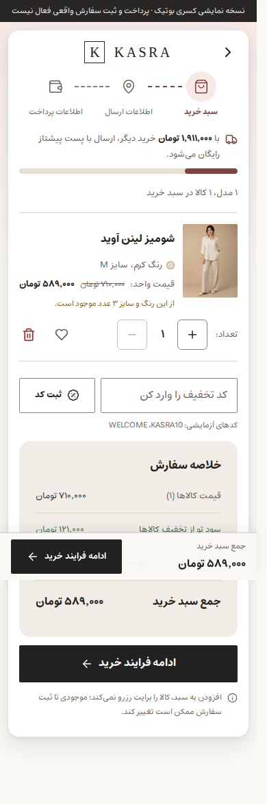
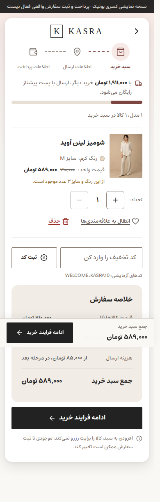

# ممیزی و اصلاح تجربهٔ ویترین کسری بوتیک

تاریخ تکمیل: ۲۰ اکتبر ۲۰۲۶ — [Draft PR #14](https://github.com/Iman-gholami/kasra-sol/pull/14)

## دامنه و منشأ شواهد

ممیزی ادامهٔ مأموریت قبلی است؛ بازطراحی از صفر انجام نشده است. مرورگر ابری Preview عمومی را باز کرد و مسیر خرید نمایشی بررسی شد. به علت نبود API تغییر viewport در مرورگر ابری و اجرا نشدن Chromium محلی، بررسی پاسخ‌گویی با Chromium واقعی در GitHub Actions انجام شد.

- مبنای درخواستی کاربر و تصاویر Before: `54a7af4c5fb6bca65b55d2e2169538833123ea63`.
- آخرین main هنگام تکمیل: `f4d16ab501900016cc831d25127314d19519c154`؛ در تاریخ شاخه وجود دارد.
- کامیت اجرایی تصاویر After: `dcb62417b66d5aa63f8a9a06072827446c4d919b`.
- شاخه: `astra/storefront-ux-refinement`؛ PR همچنان Draft و بدون Merge است.
- تغییرات ظاهری PR #13 قبلاً وارد main شده‌اند و در After دیده می‌شوند. این گزارش آن‌ها را دستاورد PR #14 محسوب نمی‌کند؛ Before/After تاریخی، مقایسهٔ خالص دو اصلاح این PR نیست.
- اجرای ایزوله: `NEXT_PUBLIC_BACKEND_ENABLED=false` و `BACKEND_INTERNAL_URL=''`، داده‌های محلی نمایشی و پرداخت شبیه‌سازی‌شده. Backend، Database، Admin و اطلاعات مشتریان تغییر نکرده‌اند. Production منتشر نشده است.

## ارزیابی و هویت برند

هویت فعلی منسجم است: پس‌زمینهٔ کرم، رنگ تأکیدی آجری، متن تیره، فونت Estedad، نشان نوشتاری KASRA، عکاسی ادیتوریال و فضای خالی فراوان. ساختار صفحهٔ محصول، خلاصهٔ سفارش، قیمت و مسیر مرحله‌ای خرید قابل فهم است. نیازی به تغییر پالت، فونت، معماری صفحات یا افزودن تزئینات دیده نشد. تصاویر و اطلاعات محصول نمایشی‌اند و کیفیت محتوای فروشگاه واقعی از آن‌ها قابل نتیجه‌گیری نیست.

## یافته‌ها و اولویت‌بندی

| اولویت | بخش | شاهد و اثر | اقدام |
|---|---|---|---|
| P2 | Checkout | پس از ارسال فرم خالی و اصلاح نام، ۵ فیلد نامعتبر باقی می‌ماند اما پیام همچنان ۶ خطا می‌گفت؛ در ۳۹۰ و ۱۴۴۰ بازتولید شد | شمارش از خطاهای فعلی مشتق می‌شود؛ بعد از اصلاح نام ۵ نمایش داده می‌شود |
| P2 | سبد خرید | قلب بدون عنوان قابل‌مشاهده، کالا را از سبد به علاقه‌مندی‌ها منتقل می‌کرد؛ پیامد عمل پیش از کلیک روشن نبود | متن «انتقال به علاقه‌مندی‌ها» و «حذف»، نام دسترس‌پذیر دقیق و چیدمان قابل شکستن با هدف لمس ۴۴px |
| P3 | فرم نشانی | الزامی بودن مجموعهٔ اطلاعات در ابتدای بخش به‌صورت متن توضیح داده نمی‌شد | راهنمای کوتاه الزامی/اختیاری بدون تغییر اعتبارسنجی یا منطق سفارش |
| P2، باز | گالری موبایل | axe در حالت گالری ۳۹۰px دو لینک breadcrumb پشت گالری را با `target-size` و شدت serious گزارش می‌کند؛ در Before و After مشترک است | نیازمند بررسی مستقل جداسازی محتوای پس‌زمینه و اندازهٔ هدف؛ رفع‌شده اعلام نمی‌شود |

P0/P1 در مسیرهای آزمایش‌شده مشاهده نشد؛ این به معنای تضمین نبود خطا در تمام شرایط نیست.

## بررسی صفحات

| صفحه/حالت | نتیجه |
|---|---|
| خانه | سلسله‌مراتب عنوان، تصاویر و CTA با هویت فعلی سازگار؛ طول صفحهٔ موبایل زیاد اما گروه‌بندی‌ها مشخص است؛ بازطراحی انجام نشد |
| کاتالوگ | کارت‌ها، قیمت‌ها، فیلتر و دسته‌ها خوانا؛ پنل فیلتر موبایل باز و بسته شد؛ تصاویر نمایشی تکراری محدودیت محتواست |
| محصول | رنگ، سایز، قیمت، راهنمای سایز و گالری بررسی شد؛ هشدار دسترس‌پذیری گالری در بالا ثبت شده است |
| سبد | ابهام عملیات رفع شد؛ انتقال و بازگرداندن کالا در موبایل و دسکتاپ موفق بود |
| Checkout | خطاهای درون فیلد، شمارنده، اطلاعات نمونه، انتخاب ارسال و رفتن به پرداخت بررسی شد |
| پرداخت و تأیید | پرداخت صرفاً شبیه‌سازی شد؛ صفحهٔ موفقیت نمایشی نمایش داده شد |
| علاقه‌مندی خالی و جستجوی بی‌نتیجه | حالت خالی و مسیر بازگشت در ماتریس تصاویر ثبت شد |
| FAQ | تیتر و ساختار محتوا در ماتریس اندازه‌ها بررسی شد |
| درباره/تماس | در مرورگر ابری مشاهده شد؛ محتوای نمونه با ادعای تجاری ساختگی جایگزین نشد |
| منو، جستجو، فیلتر و راهنمای سایز | حالت باز در تصاویر موجود است؛ بستن با Escape آزمایش شد؛ بازگشت فوکوس منوی موبایل assertion دارد |

## موبایل، RTL و دسترس‌پذیری

عرض‌های ۳۲۰، ۳۶۰، ۳۹۰، ۴۳۰، ۷۶۸، ۱۰۲۴، ۱۲۸۰، ۱۴۴۰ و ۱۹۲۰ پیکسل آزمایش شدند. ۸ مسیر اصلی در هر عرض، به‌علاوه حالت‌های تعاملی، جمعاً ۸۶ تصویر برای هر نسخه تولید کردند. هیچ overflow افقی یا تصویر بارگذاری‌نشده در نتایج ثبت نشد؛ جهت سند در همهٔ حالات RTL بود. کنترل‌های جدید سبد در موبایل به خط بعد می‌روند و با کنترل تعداد تداخل ندارند.

برای هر نسخه ۳۰ اسکن axe با قواعد WCAG 2 A/AA، 2.1 AA و 2.2 AA اجرا شد: ۲۹ حالت بدون violation؛ یک حالت گالری موبایل دارای هشدار بالا. اسکریپت، violationهای axe را ثبت می‌کند ولی آن‌ها را شرط شکست job نکرده است؛ بنابراین سبز بودن CI به معنای انطباق کامل دسترس‌پذیری نیست. تست با صفحه‌خوان و دستگاه فیزیکی iOS/Android انجام نشده است. تصاویر full-page عناصر fixed را در محل viewport نخست ثبت می‌کنند؛ قرار گرفتن نوار ثابت در میانهٔ تصویر بلند به‌تنهایی نشانهٔ خرابی چیدمان نیست.

## اعتبارسنجی فنی

- Lint، TypeScript و ۴ تست واحد محلی موفق.
- ساخت و Lint/Typecheck هر دو نسخه در [اجرای ایزوله](https://github.com/Iman-gholami/kasra-sol/actions/runs/39294849390) موفق.
- سناریوی شمارش خطا، پرکردن دادهٔ نمونه، پرداخت نمایشی، انتقال به علاقه‌مندی و Undo در ۳۹۰ و ۱۴۴۰ موفق؛ خطای JavaScript ثبت نشده است.
- [Storefront CI](https://github.com/Iman-gholami/kasra-sol/actions/runs/39294997583) موفق.
- [Admin panel E2E موجود](https://github.com/Iman-gholami/kasra-sol/actions/runs/39294997621) به‌صورت خودکار موفق؛ هیچ کد Admin تغییر نکرد.
- ساخت محلی به محدودیت محیط `/proc/self/statm` برخورد کرد؛ ساخت موفق روی runner مستقل جایگزین آن است.

## تصاویر Before / After

تصاویر زیر از اجرای پین‌شدهٔ CI هستند. فایل‌های قدیمی مرورگر ابری با provenance متغیر در این مجموعه استفاده نشده‌اند.

| موضوع | Before | After |
|---|---|---|
| سبد موبایل ۳۹۰ | [تصویر](astra-evidence/verified/before-cart-390.png) | [تصویر](astra-evidence/verified/after-cart-390.png) |
| سبد دسکتاپ ۱۴۴۰ | [تصویر](astra-evidence/verified/before-cart-1440.png) | [تصویر](astra-evidence/verified/after-cart-1440.png) |
| خطاهای Checkout موبایل | [تصویر](astra-evidence/verified/before-checkout-errors-390.png) | [تصویر](astra-evidence/verified/after-checkout-errors-390.png) |
| خطاهای Checkout دسکتاپ | [تصویر](astra-evidence/verified/before-checkout-errors-1440.png) | [تصویر](astra-evidence/verified/after-checkout-errors-1440.png) |

[نتایج ماشینی Before](astra-evidence/verified/before-results.json) · [نتایج ماشینی After](astra-evidence/verified/after-results.json)

مجموعهٔ کامل ۱۷۲ تصویر در artifactهای `astra-before` و `astra-after` همان اجرای CI است (انقضای اعلام‌شده: ۱۷ ژانویهٔ ۲۰۲۷). تصاویر منتخب و JSONها در repository ماندگارند.

## فرضیه‌های CRO و امتیازهای کیفی

شفاف شدن انتقال کالا می‌تواند خروج ناخواسته از سبد را کم کند؛ شمارش صحیح خطا می‌تواند اطمینان هنگام اصلاح فرم را افزایش دهد. این‌ها فرضیه‌اند، نه افزایش تبدیل اندازه‌گیری‌شده. هیچ analytics مشتری یا A/B test واقعی اجرا نشده است.

امتیازها قضاوت کیفی از ۱۰ هستند، نه نتیجهٔ پژوهش کاربر؛ Before مبنای تاریخی و After شامل PR #13 نیز هست.

| معیار | Before | After |
|---|---:|---:|
| هویت بصری | ۸ | ۸ |
| تایپوگرافی | ۸ | ۸ |
| فاصله‌گذاری | ۷ | ۸ |
| هماهنگی کامپوننت‌ها | ۷ | ۸ |
| ناوبری | ۸ | ۸ |
| کشف محصول | ۸ | ۸ |
| وضوح عملیات سبد | ۶ | ۸ |
| بازخورد فرم | ۶ | ۸ |
| تجربهٔ موبایل و RTL | ۷ | ۸ |
| دسترس‌پذیری | ۷ | ۷ |

## موارد باقی‌مانده و تصمیم انتشار

هشدار گالری موبایل، بررسی دستی صفحه‌خوان و تست روی دستگاه واقعی باقی است. عملکرد production، دادهٔ واقعی، درگاه واقعی و معیارهای سرعت شبکهٔ کاربران خارج از این ممیزی ایزوله‌اند. هیچ محتوای حقوقی/ارسال/مرجوعی واقعی ساخته نشده است. PR برای بازبینی Draft می‌ماند؛ Merge فقط با اجازهٔ کاربر.
