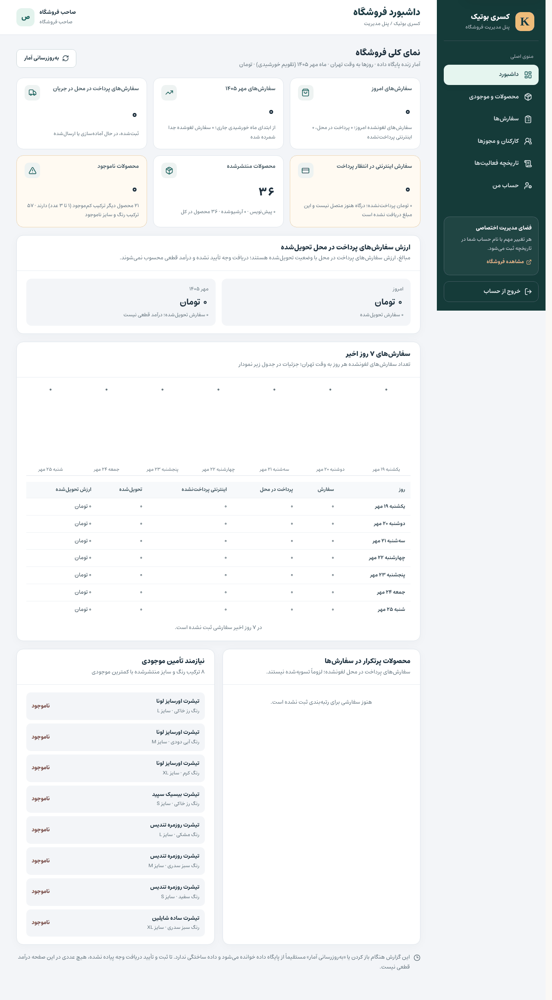
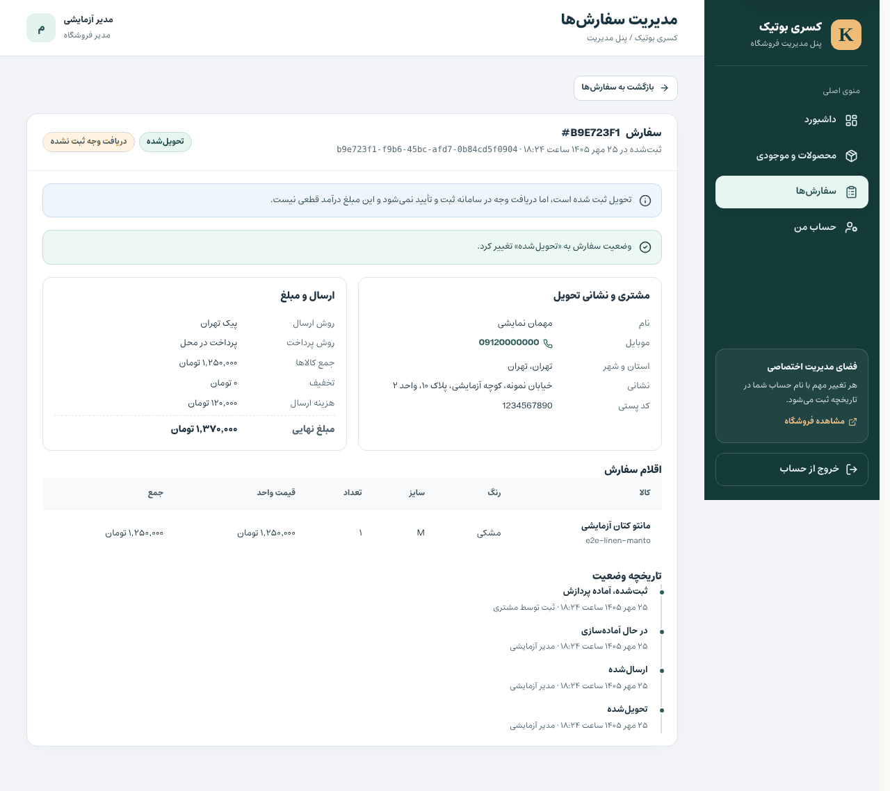
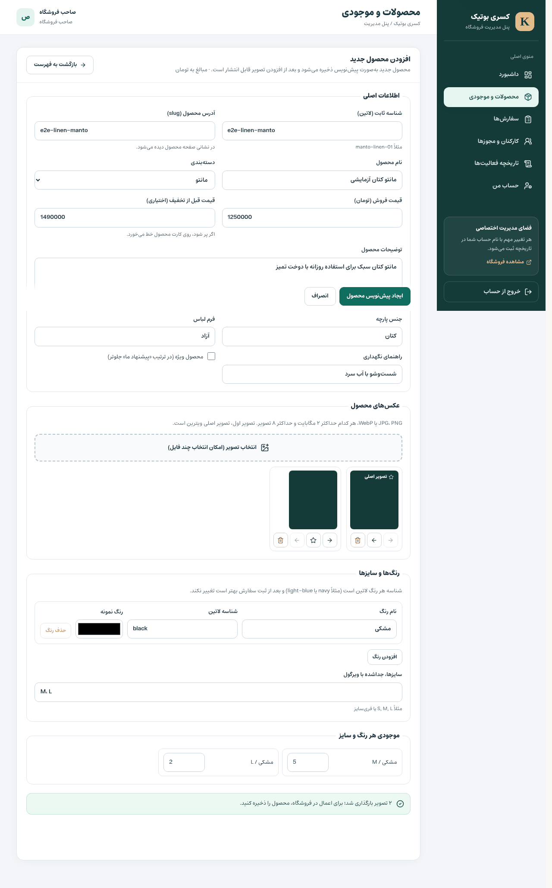
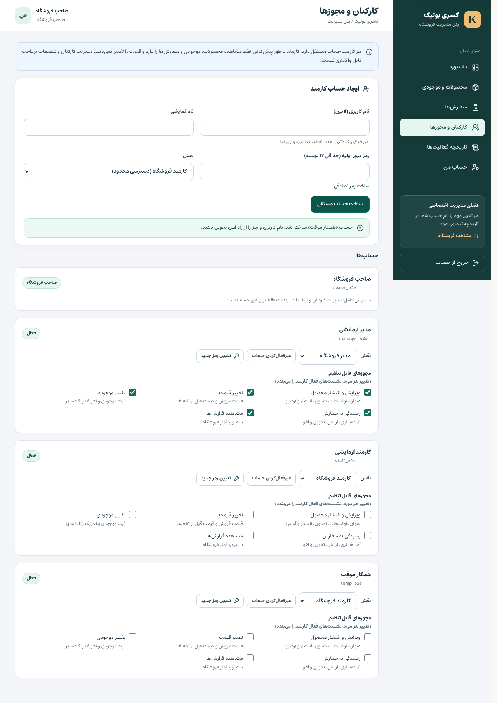
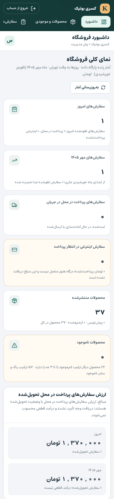
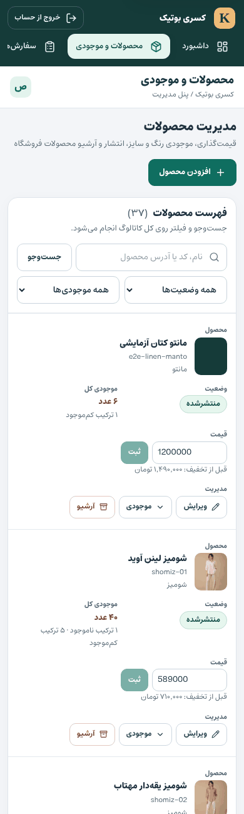

# گزارش فنی بررسی و اصلاح PR #6 و PR #7 — کسری بوتیک

تاریخ: ۲۵ مهر ۱۴۰۵ (2026-10-17) · محدوده: `Iman-gholami/kasra-sol`
PRها: [#6 `feat/fastify-postgres-backend`](https://github.com/Iman-gholami/kasra-sol/pull/6) و [#7 `feat/admin-rbac-foundation`](https://github.com/Iman-gholami/kasra-sol/pull/7)

> هیچ PRی Merge نشد، هیچ استقراری روی سرور انجام نشد، هیچ Force Push یا بازنویسی تاریخچه‌ای رخ نداد و شاخه‌های اصلی PR #6 و PR #7 دست‌نخورده ماندند. همه اصلاحات در دو شاخه جدا Commit شده‌اند (بخش ۸).

---

## ۰. خلاصه اجرایی

- کد واقعی هر دو PR (نه توضیحات آن‌ها) خط‌به‌خط بررسی شد و قبل از هر تغییر، وضعیت پایه با PostgreSQL و Redis واقعی اجرا شد (همه تست‌های موجود و CI سبز بودند).
- **۱۱ مشکل در PR #6** و **۲۰ مشکل در PR #7** پیدا و اصلاح شد؛ از جمله چند مورد با شدت High:
  - rate-limit عملاً سراسری بود: چون همه بازدیدکننده‌ها از پشت سرور Next.js می‌آمدند، ۵ تلاش ورود در دقیقه از سوی هر کسی ورود **همه** کارکنان را می‌بست و ۱۲ سفارش در دقیقه سقف **کل فروشگاه** بود. پاسخ محدودیت هم به‌جای 429 خطای 500 بود (هر دو روی کد اصلی بازتولید شد).
  - ثبت دستی موجودی در پنل مقدار مطلق را بدون کنترل هم‌زمانی بازنویسی می‌کرد و می‌توانست واحدهای فروخته‌شده را دوباره قابل‌فروش کند (Overselling).
  - فهرست سفارش‌های پنل اقلام، موبایل، نشانی و کد پستی را نشان نمی‌داد؛ یعنی کارمند عملاً نمی‌توانست سفارش را ارسال کند.
  - مقادیر نمونه `.env.example` به‌عنوان Secret معتبر پذیرفته می‌شدند.
  - Next.js 16.3.5 (نسخه پین‌شده در `main`) هشدار امنیتی Critical داشت (از جمله SSRF در Image Optimization).
- قانون پرداخت در **سطح دیتابیس** قفل شد: هیچ سفارشی (حتی با SQL دستی) نمی‌تواند «پرداخت‌شده» ثبت شود و سفارش اینترنتی پرداخت‌نشده هرگز وارد آماده‌سازی، ارسال یا تحویل نمی‌شود؛ فقط قابل لغو است. هیچ پرداخت یا تأیید ساختگی ساخته نشد.
- پنل مدیریت برای استفاده روزانه بازسازی شد: جزئیات و چرخه کامل سفارش (همراه با لغو و برگشت موجودی)، جست‌وجو و صفحه‌بندی سمت سرور، مجوزهای فیلدی، قفل موقت حساب، تغییر و بازنشانی رمز، گزارش‌ها بر پایه ماه خورشیدی، طراحی RTL واکنش‌گرا با کنتراست AA، و حذف کامل هدر و فوتر فروشگاه از پنل.
- تست‌ها: **۲۱ تست واحد، ۳۰ تست Integration روی PostgreSQL واقعی، ۷۸ تست Playwright ویترین و ۱۱ تست E2E پنل** با نقش‌های Owner، Manager و Staff روی API و دیتابیس واقعی، همه سبز. Migrationها روی داده‌های ساخته‌شده با کد قبلی هم آزمایش شدند و همه سفارش‌ها، اقلام، محصولات و موجودی دست‌نخورده ماندند.
- **هشدار Critical یا High شناخته‌شده‌ای در کد باقی نمانده است.** پیش‌نیازهای عملیاتی Production (HTTPS، Secretهای واقعی، 2FA، بکاپ، اتصال واقعی درگاه) در بخش ۱۰ فهرست شده‌اند.

---

## ۱. روش بررسی و وضعیت پایه

| مورد | نتیجه پیش از تغییر |
|---|---|
| ترتیب شاخه‌ها | `main (deeef2a)` ← PR #6 `21ce968` ← PR #7 `308b5f6`. PR #7 روی `d2faddf` ساخته شده و دو Commit آخر PR #6 (اصلاح دسترس‌پذیری لینک علاقه‌مندی) را با یک Commit هم‌ارز خودش دارد؛ ادغام بدون تعارض انجام شد. |
| CI روی GitHub | هر دو PR: `backend` ✓ و `verify` ✓ |
| بک‌اند PR #7 (محلی، PostgreSQL 16 و Redis 7) | typecheck ✓ · ۱۶/۱۶ تست واحد · build ✓ · smoke و admin-smoke ✓ |
| فرانت‌اند PR #7 | lint بدون خطا (۳ هشدار) · typecheck ✓ · build ✓ · Playwright ۷۸/۷۸ |

برای بازتولید باگ‌ها، کد اصلی هر PR در یک worktree جداگانه build و اجرا شد. نمونه (کد اصلی PR #6، پشت پراکسی): ۱۳ درخواست از ۱۳ بازدیدکننده متفاوت ← `400 ×12, 500` و یک لاگ خطای 500 برای پاسخ rate-limit.

---

## ۲. مشکلات PR #6 (بک‌اند Fastify/PostgreSQL، سفارش و Checkout)

| شناسه | شدت | مشکل و علت اصلی | اصلاح | تست |
|---|---|---|---|---|
| P6-01 | **High** | **rate-limit سراسری.** API فقط از سرور Next.js فراخوانی می‌شود و `trustProxy` خاموش بود، پس همه بازدیدکننده‌ها یک IP داشتند: ۱۲ سفارش، ۱۲۰ درخواست و ۵ ورود مدیریتی در دقیقه برای **کل فروشگاه**؛ یعنی یک نفر می‌توانست Checkout و ورود همه را ببندد. | تنظیم `TRUST_PROXY` (پیش‌فرض خاموش؛ در Compose روشن، چون پورت API فقط روی loopback و شبکه داخلی است). پراکسی‌ها و صفحه‌های SSR آدرس بازدیدکننده را (آخرین مقدار `X-Forwarded-For` که Nginx اضافه می‌کند) به API می‌فرستند. | Integration: «limits each client separately» |
| P6-02 | Medium | پاسخ rate-limit با **کد 500** برمی‌گشت و به‌عنوان خطای سرور لاگ می‌شد، چون `errorResponseBuilder` شیء بدون `statusCode` برمی‌گرداند. | `statusCode` در builder و پاسخ صریح `429 rate_limited` در error handler. | همان تست (۱۳امین درخواست = 429) |
| P6-03 | Medium | **Secretهای نمونه پذیرفته می‌شدند.** مقادیر `.env.example` (۵۹ و ۴۶ کاراکتر) شرط «حداقل ۳۲ کاراکتر» را پاس می‌کردند؛ با دستور README (`cp .env.example .env`) توکن رسید سفارش با کلیدی عمومی امضا می‌شد و کلید API قدیمی موجودی هم عمومی بود. `ORDER_TOKEN_SECRET` هم فقط در production بررسی می‌شد. | `src/config.ts`: رد مقادیر نمونه، الزام `ORDER_TOKEN_SECRET` هنگام شروع در همه محیط‌ها، رد رمز نمونه PostgreSQL در production. راهنمای `openssl rand -hex 32`. | `tests/config.test.ts` |
| P6-04 | Medium | **نبود ضمانت در دیتابیس برای وضعیت سفارش.** `status`، `payment` و `shipping` متن آزاد بودند، رابطه مبلغ نهایی کنترل نمی‌شد و «پرداخت‌نشده» فقط یک رشته ثابت در کد بود؛ هیچ مانع ساختاری جلوی ثبت «پرداخت‌شده» یا ارسال سفارش اینترنتی پرداخت‌نشده نبود. | Migration افزایشی `004_order_integrity`: محدودیت‌های CHECK برای مقادیر مجاز، `total = subtotal - discount + shipping_cost`، ستون `payment_status` که **فقط `unpaid`** را می‌پذیرد، منع وضعیت آماده‌سازی، ارسال یا تحویل برای سفارش اینترنتی، و ایندکس `(status, created_at)`. رسید `paymentStatus` را از دیتابیس می‌خواند. | تست: حتی `UPDATE` مستقیم SQL رد می‌شود (`23514`). همین تست نشان داد نام `orders_total_check` قبلاً گرفته شده بود؛ محدودیت جدید نام جدا گرفت. |
| P6-05 | Medium | **تست هم‌زمانی، Idempotency و ایمنی پرداخت وجود نداشت** (فقط یک smoke موفق). | ۱۱ تست Integration روی PostgreSQL واقعی (بخش ۷). | — |
| P6-06 | Low | Redis با `retryStrategy: () => null` پس از یک قطعی هرگز دوباره وصل نمی‌شد و کش تا راه‌اندازی مجدد API خاموش می‌ماند. | backoff محدود (حداکثر ۱۰ ثانیه)؛ تا زمان وصل‌شدن، داده بدون کش از دیتابیس خوانده می‌شود. | — |
| P6-07 | Low | پیشنهاد جست‌وجو در هر کلید ۴۸ محصول با همه ترکیب‌ها را می‌خواند تا ۴ مورد نشان دهد. | خواندن ۴ محصول (شمارش کل جدا محاسبه می‌شود). | — |
| P6-08 | Low | `POST /api/orders` بررسی Origin نداشت (سایت دیگر می‌توانست از مرورگر بازدیدکننده سفارش ثبت کند) و بدنه را کامل می‌خواند و بعد اندازه‌اش را می‌سنجید. | بررسی هم‌مبدأ بودن (نشانی سایت یا Host) و خواندن جریانی با سقف ۳۲KB. | E2E: «cross-site requests are refused» |
| P6-09 | Low | `backend/dist` در `.gitignore` نبود. | اضافه شد. | — |
| P6-10 | **Critical** (از قبل در `main`) | Next.js **16.3.5** هشدارهای Critical/High دارد: SSRF در Image Optimization (که ویترین استفاده می‌کند)، cache poisoning و RCE در `next/og` (که در این پروژه استفاده نمی‌شود). | ارتقای `next`، `eslint-config-next` و `@next/eslint-plugin-next` به **16.3.8** (همان نسخه minor؛ منتشرشده ۳۰ سپتامبر). | `npm audit --omit=dev`: صفر؛ build و ۷۴ تست ویترین سبز |
| P6-11 | High (عملاً Low) | `drizzle-orm <0.45.2` (GHSA-gpj5-g38j-94v9، تزریق SQL از راه شناسه‌ها). کد فقط شناسه‌های ثابت schema را استفاده می‌کند، پس عملاً قابل سوءاستفاده نبود. | `^0.45.2`. | تست‌های واحد و Integration سبز |

**بدون مشکل و بدون تغییر:** محاسبه قیمت، تخفیف، هزینه ارسال و مبلغ نهایی در سرور از قیمت دیتابیس (قیمت ارسالی کاربر نادیده گرفته می‌شود و تست شد)؛ قفل `FOR UPDATE` با ترتیب ثابت روی ترکیب‌های سفارش COD همراه با کسر شرطی موجودی؛ Idempotency با advisory lock و hash درخواست؛ اعتبارسنجی Zod؛ کوئری‌های پارامتری (و escape کردن الگوی `ILIKE`)؛ توکن رسید HMAC با `timingSafeEqual`؛ خطاهای 5xx عمومی؛ بسته‌بودن پورت‌های DB و Redis؛ قفل Migration.

---

## ۳. مشکلات PR #7 (پنل مدیریت، RBAC، محصولات، سفارش‌ها، داشبورد)

### امنیت و احراز هویت

| شناسه | شدت | مشکل و علت اصلی | اصلاح | تست |
|---|---|---|---|---|
| P7-01 | **High** | **Brute force و DoS ورود.** فقط محدودیت ۵ ورود در دقیقه بر اساس IP وجود داشت که به‌دلیل P6-01 سراسری بود: هر کسی با ۵ درخواست ورود همه را می‌بست، و برای حدس رمز از IPهای متعدد هیچ حفاظتی در سطح حساب نبود. | محدودیت بر اساس هر بازدیدکننده، به‌علاوه **قفل ۱۵ دقیقه‌ای حساب پس از ۱۰ تلاش ناموفق** با همان پاسخ عمومی `invalid_credentials` (بدون افشای وجود حساب). scrypt حتی برای حساب قفل یا ناموجود اجرا می‌شود تا زمان پاسخ چیزی را لو ندهد. ثبت ورود موفق، ناموفق و قفل در Audit. | Integration: قفل، پاسخ یکسان، باز شدن با بازنشانی رمز |
| P7-02 | Medium | **امکان تغییر یا بازنشانی رمز وجود نداشت.** رمز Owner را فقط با bootstrap اولیه می‌شد تعیین کرد (امکان چرخش نبود) و رمز فراموش‌شده کارمند فقط با دسترسی مستقیم به دیتابیس قابل حل بود. | `POST /auth/password` (رمز فعلی لازم است و نشست‌های دیگر بسته می‌شوند) و `PUT /staff/:id/password` فقط برای Owner (نشست‌ها بسته و قفل باز می‌شود). Audit بدون ثبت رمز. | Integration و E2E |
| P7-03 | Medium | **Audit ناقص.** ویرایش کامل محصول قیمت و موجودی قبل و بعد را ثبت نمی‌کرد؛ ورود، خروج، ورود ناموفق، تغییر رمز و آپلود ثبت نمی‌شدند؛ تغییر قیمت و موجودی مقدار قبلی را نداشت. | Audit ساختاریافته: فیلدهای تغییرکرده، قیمت و موجودی «از ← به» و همه رویدادهای حساب. | Integration (`details.fields`, `from/to`) |
| P7-04 | Medium | **پراکسی آپلود** کل بدنه را پیش از بررسی اندازه در حافظه می‌خواند، در حالی که بررسی کوکی فقط قالب آن را می‌سنجید؛ پس درخواست بدون احراز هویت با بدنه chunked نامحدود می‌توانست حافظه را پر کند (در production، `client_max_body_size 2m` در Nginx این را محدود می‌کند). | خواندن جریانی با سقف سخت ۲MB در همه پراکسی‌ها؛ فهرست مجاز دقیق مسیرها و پارامترهای query. | — |
| P7-05 | Low | بررسی Origin فقط با `NEXT_PUBLIC_SITE_URL` انجام می‌شد؛ در نتیجه ورود از `127.0.0.1` وقتی نشانی سایت `localhost` بود شکست می‌خورد. | مقایسه با نشانی سایت یا Host (هدر `X-Forwarded-Host` که کلاینت می‌تواند بفرستد عمداً نادیده گرفته می‌شود). | E2E |
| P7-06 | Low | نشست‌های منقضی هرگز پاک نمی‌شدند. | پاک‌سازی هنگام ورود. | — |

### موجودی، محصولات و هم‌زمانی

| شناسه | شدت | مشکل و علت اصلی | اصلاح | تست |
|---|---|---|---|---|
| P7-07 | **High** | **از دست رفتن به‌روزرسانی موجودی.** «ثبت موجودی» در فهرست، عدد مطلق دیده‌شده در فرم را می‌نوشت؛ اگر بین بازکردن فرم و ثبت سفارشی ثبت می‌شد، کسر موجودی بازنویسی و واحد فروخته‌شده دوباره قابل‌فروش می‌شد. | الزام `expectedStock`؛ اگر مقدار عوض شده باشد پاسخ `409 stock_changed` با موجودی واقعی برمی‌گردد و UI مقدار تازه را نشان می‌دهد. | Integration: سفارش در فاصله ← 409 ← ثبت صحیح |
| P7-08 | Medium | **فهرست محصولات پنل حداکثر ۱۰۰ ردیف** (`LIMIT 100`) بود و جست‌وجو فقط در مرورگر انجام می‌شد؛ از کالای ۱۰۱ به بعد دیده یا پیدا نمی‌شد. | جست‌وجوی سمت سرور (نام فارسی نرمال‌شده، شناسه و slug)، فیلتر وضعیت و موجودی، و صفحه‌بندی. | Integration و E2E |
| P7-09 | Medium | **مجوزهای ویرایش کامل محصول بیش از حد سخت‌گیرانه بود.** هر ویرایشی (حتی فقط توضیحات) هر سه مجوز را لازم داشت، پس کارمند محتوا عملاً کاری نمی‌توانست بکند. | مجوز در سطح فیلد: محتوا با `products:write`؛ تغییر قیمت با `products:price`؛ تغییر موجودی یا ترکیب‌ها با `inventory:write` (پاسخ 403 نام مجوز لازم را برمی‌گرداند). ویرایشگر فیلدهای بدون مجوز را غیرفعال نشان می‌دهد. | Integration: کارمند محتوا ← قیمت 403، موجودی 403، توضیحات 200 |
| P7-10 | Medium | **پیش‌نویس و آرشیو یکی بودند** و داشبورد پیش‌نویس‌ها را «آرشیوشده» می‌شمرد. | ستون `archived_at`: برداشتن محصول منتشرشده از فروش، آن را آرشیو می‌کند و محصول هرگز منتشرنشده پیش‌نویس می‌ماند (با CHECK و بازسازی داده‌های قبلی از Audit). | Integration |
| P7-11 | Medium | **بخش «خرید بر اساس رنگ» و «منتخب‌ها»ی صفحه اصلی** حتی با API فعال از داده‌های نمونه ثابت می‌خواندند؛ محصول آرشیوشده با لینک 404 می‌ماند و محصول جدید پنل در آن دیده نمی‌شد. | استفاده از همه محصولات منتشرشده API (با صفحه‌بندی و کش). حالت نمایشی بدون تغییر ماند. | E2E |
| P7-12 | Low | تغییر سریع قیمت می‌توانست قیمت فروش را بالاتر از «قیمت قبل از تخفیف» بگذارد و تخفیف منفی نمایش داده شود. | پاسخ `409 price_above_original`. | Integration |
| P7-13 | Low | الگوهای `pattern` در فرم‌ها (`[a-z0-9-]`) با پرچم `v` مرورگر نامعتبر بودند؛ نتیجه، خطای Console و نبود اعتبارسنجی سمت کاربر بود. | escape صحیح (`\-`). | E2E (Console بدون خطا) |

### سفارش‌ها و پرداخت

| شناسه | شدت | مشکل و علت اصلی | اصلاح | تست |
|---|---|---|---|---|
| P7-14 | **High** | **سفارش در پنل قابل پردازش نبود.** فهرست اقلام، رنگ و سایز، موبایل، نشانی کامل و کد پستی را نشان نمی‌داد و وضعیت‌ها کدهای خام بودند (`confirmed_cod · cod`). | فهرست با فیلتر، جست‌وجو (موبایل با ارقام فارسی، نام، کد) و صفحه‌بندی، بدون نمایش موبایل در فهرست. صفحه جزئیات شامل نشانی، اقلام، مبالغ و **تاریخچه وضعیت** با برچسب‌های فارسی و هشدار پرداخت. | Integration و E2E |
| P7-15 | Medium | **امکان لغو سفارش وجود نداشت.** موجودی سفارش COD لغوشده هرگز به انبار برنمی‌گشت و سفارش اینترنتی پرداخت‌نشده هم قابل بستن نبود. | لغو COD از «ثبت‌شده» یا «در حال آماده‌سازی» با **برگشت موجودی در همان تراکنش** (و ترتیب قفل یکسان با Checkout)؛ سفارش اینترنتی پرداخت‌نشده فقط قابل لغو است. یادداشت داخلی اختیاری. | Integration: برگشت دقیقاً یک‌باره موجودی و رد لغو دوباره |
| P7-16 | Medium | دوبار کلیک یا کلیک هم‌زمان دو کارمند، پیام خطای مبهم «کد 409» نشان می‌داد و تأییدی برای تغییرات برگشت‌ناپذیر گرفته نمی‌شد. | قفل ردیف و ثبت دقیقاً یک انتقال، پیام فارسی، پرسش تأیید و حالت در حال انجام. | Integration: دو PATCH هم‌زمان ← `[200, 409]` |
| P7-17 | Low | سفارش نام رنگ را ذخیره نمی‌کرد و پس از ویرایش رنگ‌های محصول معلوم نبود چه رنگی سفارش داده شده است. | snapshot `order_items.color_name` (همراه با پرکردن داده‌های قبلی). | Integration: تغییر نام و رنگ و آرشیو محصول، سفارش را تغییر نمی‌دهد |

**ایمنی پرداخت (ممیزی‌شده):** فقط سفارش COD مراحل `ثبت‌شده ← آماده‌سازی ← ارسال ← تحویل` را طی می‌کند. سفارش `pending_payment` در API، UI و دیتابیس هیچ مسیری به این مراحل ندارد. «تحویل‌شده» به معنی «وجه دریافت‌شده» نیست و در UI با برچسب «دریافت وجه ثبت نشده» نشان داده می‌شود.

### داشبورد آماری

| شناسه | شدت | مشکل | اصلاح |
|---|---|---|---|
| P7-18 | Medium | «ماه» میلادی بود؛ ارزش تحویل‌شده از متن Audit Log (رکورد امنیتی) با join متنی استخراج می‌شد؛ سفارش لغوشده تعریف نشده بود؛ کم‌موجودی فقط در سطح ترکیب رنگ و سایز بود؛ نمودار فقط ارزش تحویل‌شده را نشان می‌داد. | **ماه خورشیدی جاری به وقت تهران** (با تست مرزهای ماه و نوروز)، جدول `order_status_history` به‌عنوان منبع، حذف لغوشده‌ها از شمارش سفارش، تعداد محصولات ناموجود و کم‌موجود، نمودار ۷ روزه تعداد سفارش همراه با جدول داده قابل دسترس، و مبلغ سفارش‌های اینترنتی پرداخت‌نشده با برچسب «دریافت نشده». هیچ عددی «درآمد» نامیده نمی‌شود. همه ارقام مستقیماً از کوئری SQL می‌آیند (Integration مقدار دقیق تغییر را می‌سنجد). |

### UI/UX و دسترس‌پذیری

| شناسه | شدت | مشکل | اصلاح |
|---|---|---|---|
| P7-19 | Medium | هدر، فوتر، نوار پایین و کشوی سبد فروشگاه در پنل فقط با CSS **پنهان** بودند؛ DOM، لینک پرش به محتوا و درخواست‌های سبد خرید در پنل اجرا می‌شدند. | کامپوننت `StoreChrome` که آن‌ها را در مسیرهای `/admin` اصلاً رندر نمی‌کند و لینک پرش اختصاصی پنل. |
| P7-20 | Medium | کدهای خام در UI، پیام‌های خطای «کد ۴۰۹»، نبود بازخورد برای چک‌باکس مجوزها، جدول ۸۲۰ پیکسلی با اسکرول افقی در موبایل، متن کم‌کنتراست (حدود 3:1)، دکمه درون label، و نبود صفحه حساب و تاریخچه خوانا. | بازطراحی منسجم RTL: توکن‌های رنگ با کنتراست AA، جدول‌هایی که در موبایل به کارت دوستونه تبدیل می‌شوند، نشان‌های وضعیت، پیام‌های فارسی برای هر کد خطا، حالت‌های Loading و Empty، تمرکز صفحه‌کلید روی عنوان هر بخش، `aria-current`، `role=alert/status`، نمایش رمز، صفحه «حساب من»، تاریخچه فعالیت خوانا، سقف ۸ تصویر با بارگذاری چندتایی و جابه‌جایی تصاویر با دکمه‌های قابل استفاده با صفحه‌کلید. |

**بدون مشکل و حفظ‌شده:** هش scrypt با salt تصادفی و `timingSafeEqual`؛ توکن نشست ۲۵۶ بیتی که فقط SHA-256 آن ذخیره می‌شود؛ کوکی HttpOnly با SameSite=Strict و Secure روی HTTPS؛ کنترل مجوز در Backend برای همه مسیرها؛ غیرقابل‌واگذاری بودن `staff:manage` و `payments:configure`؛ عدم امکان تغییر حساب خود یا حساب Owner؛ بسته‌شدن نشست‌ها هنگام تغییر نقش، مجوز یا غیرفعال‌سازی؛ کنترل آپلود (بایت‌های امضای فایل، تطابق MIME، ۲MB، نام UUID، `wx`، `nosniff` و `CSP sandbox`) و جلوگیری از Path Traversal؛ کنترل هم‌زمانی ویرایش کامل محصول با ETag؛ آرشیو به‌جای حذف.

---

## ۴. پرداخت DigiPay BNPL — آمادگی معماری (بدون پیاده‌سازی ساختگی)

**موجود و کافی برای مرحله فعلی:** وضعیت `pending_payment` برای سفارش‌های اینترنتی، ستون `payment_status` که در دیتابیس فقط مقدار `unpaid` را می‌پذیرد، محدودیت دیتابیسی منع ورود سفارش پرداخت‌نشده به چرخه ارسال، Idempotency در ثبت سفارش، و عدم رزرو موجودی برای سفارش اینترنتی.

**لازم پیش از فعال‌سازی (در یک Migration و PR جدا):**
1. جدول `payments` شامل provider، شناسه تراکنش (`UNIQUE(provider, reference)`)، مبلغ، وضعیت (`initiated/authorized/settled/failed/refunded`)، داده خام callback، زمان‌ها و نتیجه بررسی امضا.
2. Callback فقط با بررسی امضا و فراخوان verify سرور به سرور، تطابق مبلغ و `order_id` و تسویه Idempotent در یک تراکنش همراه با قفل ردیف سفارش. تکرار callback نباید دوبار تسویه کند.
3. تصمیم درباره موجودی سفارش اینترنتی: رزرو هنگام ثبت با زمان انقضا (و job لغو سفارش‌های منقضی)، یا کسر هنگام تسویه با سیاست مشخص برای نبود موجودی (لغو و بازپرداخت).
4. برای BNPL، تفکیک «مجاز شده» از «تسویه‌شده» و مسیر بازپرداخت و تطبیق مالی.
5. فقط پس از این موارد، محدودیت `orders_payment_status_check` و `orders_online_requires_payment_check` در همان Migration گسترش داده شود.

---

## ۵. موارد باقی‌مانده و تصمیم‌های صاحب فروشگاه

| # | موضوع | توضیح | نوع |
|---|---|---|---|
| D1 | پرداخت اینترنتی پیش از اتصال درگاه | اکنون مشتری می‌تواند «سفارش در انتظار پرداخت» ثبت کند، سبدش خالی می‌شود اما راهی برای پرداخت ندارد. پیشنهاد: تا اتصال DigiPay گزینه اینترنتی غیرفعال شود (در این حالت سفارش فقط با پیک تهران و پرداخت در محل ممکن است)، یا پیام فعلی حفظ و سفارش‌ها دستی پیگیری شوند. | **تصمیم مالک** |
| D2 | کدهای تخفیف | `KASRA10` و `WELCOME` در کد ثابت‌اند و محدودیت استفاده یا انقضا ندارند. پیش از Production باید مدیریت تخفیف (تعداد استفاده، تاریخ، حداقل خرید) اضافه شود. | تصمیم و توسعه |
| D3 | قوانین ارسال | هزینه‌ها و آستانه ارسال رایگان در کد ثابت‌اند (داده نمونه). | تصمیم مالک |
| D4 | دسته‌بندی‌ها | سه دسته ثابت (شومیز، مانتو، تیشرت) به مسیرها و فیلترهای ویترین گره خورده‌اند؛ CRUD دسته‌بندی پیاده نشده است. | تصمیم و توسعه |
| D5 | سیاست قفل حساب | ۱۰ تلاش ناموفق ← ۱۵ دقیقه قفل. مهاجمی که نام کاربری را بداند می‌تواند حساب را مدام قفل نگه دارد (Owner با بازنشانی رمز کارمند آن را باز می‌کند)؛ راه‌حل نهایی 2FA است. | تصمیم |
| R1 | 2FA برای Owner و Manager | توصیه جدی پیش از Production. | امنیت |
| R2 | بازیابی رمز با پیامک یا ایمیل | فعلاً فقط بازنشانی توسط Owner وجود دارد. | توسعه |
| R3 | پردازش تصویر | تغییر اندازه و WebP، **حذف EXIF** (عکس موبایل ممکن است مختصات GPS داشته باشد)، اسکن بدافزار، پاک‌سازی فایل‌های بی‌استفاده و بکاپ `media_data`. | حریم خصوصی و عملیات |
| R4 | rate-limit چندنمونه‌ای | store فعلی در حافظه است؛ برای اجرای بیش از یک نمونه API باید از Redis استفاده شود. | عملیات |
| R5 | انقضای سفارش‌های `pending_payment` و نبود رزرو موجودی | بخش ۴. | پرداخت |
| R6 | توکن رسید | HMAC شناسه سفارش است و انقضا یا امکان ابطال ندارد. | بهبود |
| R7 | خطای API در صفحات ویترین | در نبود API صفحه خطای عمومی Next نمایش داده می‌شود؛ صفحه خطای اختصاصی و fallback لازم است. | UX |
| R8 | سربرگ‌های امنیتی | CSP و HSTS (پس از HTTPS) در Nginx یا Next اضافه شوند. | امنیت |
| R9 | Next.js روی `main` | نسخه 16.3.5 روی `main` هنوز آسیب‌پذیر است؛ اگر `main` جایی مستقر است، ارتقای 16.3.8 را جداگانه روی آن اعمال کنید. | امنیت |

---

## ۶. فایل‌های تغییرکرده

**شاخه اصلاح PR #6** (`claude/practical-pasteur-a7s581-pr6-backend`؛ ۲۱ فایل، 402+ و 35−):
- بک‌اند: `backend/src/config.ts` (جدید)، `backend/src/index.ts`، `backend/src/orders.ts`، `backend/src/db/{migrate,schema}.ts`، `backend/sql/004_order_integrity.sql` (جدید)، `backend/package.json`، `backend/README.md`
- تست و CI: `backend/tests/config.test.ts`، `backend/tests/integration/orders.integration.mjs`، `.github/workflows/backend-ci.yml`
- فرانت‌اند: `src/lib/backend-proxy.ts` (جدید)، `src/app/api/orders/route.ts`، `src/app/api/search-suggestions/route.ts`، `src/lib/backend-products.ts`، `src/lib/catalog.ts`
- پیکربندی: `compose.yaml`، `.env.example`، `.gitignore`، `package.json` و `README.md`

**شاخه اصلاح PR #7** (`claude/practical-pasteur-a7s581`؛ شامل ادغام شاخه بالا؛ نسبت به PR #7 در مجموع ۶۶ فایل، 3686+ و 1201−):
- بک‌اند: `backend/sql/005_admin_operations.sql` و ماژول‌های جدید `backend/src/admin/{audit,identity,order-routes,calendar,image-type}.ts`؛ بازنویسی `routes.ts`، `product-routes.ts`، `reports.ts` و `media.ts`
- تست: `backend/tests/integration/admin.integration.mjs`، `backend/tests/calendar.test.ts`، `tests-admin/*`، `playwright.admin.config.ts` و `.github/workflows/admin-e2e.yml`
- پنل: `src/components/admin/*` (کامپوننت‌های جدید: `admin-api`، `labels`، `ui`، `order-manager`، `staff-manager`، `account-settings`، `audit-log` و `login-form`)، `src/styles/admin.css`، `src/app/admin/*` و `src/app/api/admin/*`
- چیدمان و ویترین: `src/app/layout.tsx`، `src/components/layout/{store-chrome,site-shell}.tsx`، `src/app/page.tsx`، `src/lib/shop-by-color.ts` و `src/components/home/shop-by-color.tsx`
- مستندات: `backend/README.md`، این گزارش و `docs/audit-screenshots/*`

---

## ۷. تست‌های اجراشده و نتایج دقیق

محیط: Node 22.22، PostgreSQL 16.15 و Redis 7.0 محلی (CI از PostgreSQL 17 استفاده می‌کند)، Chromium برای Playwright. **Docker daemon در این محیط در دسترس نبود**، پس `docker compose up` اجرا نشد؛ فقط اعتبار نحوی `compose.yaml` بررسی شد و همان سرویس‌ها به‌صورت native اجرا شدند.

| مجموعه | شاخه PR #6 | شاخه PR #7 |
|---|---|---|
| Backend typecheck | ✓ | ✓ |
| Backend unit (`npm test`، بدون نیاز به دیتابیس) | **۱۰/۱۰** | **۲۱/۲۱** |
| Backend build | ✓ | ✓ |
| Migration دوباره (idempotent) و seed دوباره | ✓ | ✓ |
| `smoke.mjs` و `admin-smoke.mjs` | ✓ و — | ✓ و ✓ |
| PostgreSQL Integration (`--test-concurrency=1`) | **۱۱/۱۱** | **۳۰/۳۰** (۱۱ سفارش + ۱۹ مدیریت) |
| لاگ خطای 500 در کل اجرای Integration | ۰ | ۰ |
| ارتقای Migration روی داده ساخته‌شده با کد قبلی | ✓ (۱ سفارش با مبلغ ۱٬۲۱۰٬۰۰۰ و مجموع موجودی ۱۸۸۹ بدون تغییر) | ✓ (۲ سفارش، ۲ قلم، ۳۷ محصول، ۱۲ Audit و مجموع موجودی ۱۸۹۳ بدون تغییر؛ ۴ انتقال در تاریخچه و ۱ آرشیو بازسازی شد؛ سپس Integration **۳۰/۳۰** روی همین دیتابیس) |
| ESLint | ۰ خطا و ۰ هشدار | ۰ خطا و ۰ هشدار |
| TypeScript (Next) | ✓ | ✓ |
| Next production build | ✓ (حالت نمایشی) | ✓ (حالت نمایشی و حالت متصل به API) |
| Playwright ویترین (`tests/`) | **۷۴/۷۴** | **۷۸/۷۸** |
| Playwright پنل روی API و PostgreSQL واقعی (`tests-admin/`) | — | **۱۱/۱۱** |
| `npm audit --omit=dev` | ۰ آسیب‌پذیری | ۰ آسیب‌پذیری |

**Integration سفارش (PR #6):** ۱۲ سفارش COD هم‌زمان برای ۳ واحد آخر ← دقیقاً ۳ موفق و بقیه 409 بدون Overselling؛ ۶ تکرار هم‌زمان با یک Idempotency-Key ← یک سفارش و یک کسر موجودی؛ استفاده مجدد کلید برای سبد دیگر ← 409؛ رد مقدار بیش از موجودی؛ نادیده‌گرفتن قیمت ارسالی کاربر؛ کد تخفیف با ارقام فارسی؛ محدودیت‌های پیک و پرداخت در محل؛ سفارش اینترنتی پرداخت‌نشده بدون رزرو موجودی؛ رد SQL مستقیم برای «پرداخت‌شده» یا ارسال سفارش پرداخت‌نشده؛ خصوصی‌بودن رسید؛ rate-limit جداگانه برای هر کاربر با پاسخ 429.

**Integration مدیریت (PR #7):** قفل حساب و پاسخ یکسان؛ خروج و انقضای نشست؛ تغییر رمز؛ بسته‌شدن نشست هنگام غیرفعال‌سازی؛ همه تلاش‌های افزایش دسترسی (اعطای مجوز به خود، مجوزهای مخصوص Owner، ساخت Owner دوم، تغییر حساب Owner)؛ کارمند پیش‌فرض بدون دسترسی به قیمت، موجودی، انتشار، ساخت محصول، آپلود و گزارش؛ مجوز فیلدی برای کارمند محتوا؛ موجودی کهنه ← 409؛ ETag کهنه ← 412؛ قیمت بالاتر از قیمت قبل تخفیف ← 409؛ چرخه کامل COD با تاریخچه؛ کلیک هم‌زمان؛ لغو و برگشت دقیقاً یک‌باره موجودی؛ عدم امکان ارسال سفارش اینترنتی (حتی `status: 'paid'` ← 400)؛ ثابت‌ماندن اطلاعات سفارش پس از ویرایش و آرشیو محصول؛ جست‌وجوی موبایل با ارقام فارسی؛ صفحه‌بندی و تفکیک پیش‌نویس و آرشیو؛ دقت تغییرات گزارش (امروز، ماه خورشیدی، پرداخت‌نشده، تحویل‌شده)؛ رد SVG، MIME نادرست و فایل بزرگ‌تر از ۲MB و Path Traversal.

**E2E پنل (Owner/Manager/Staff):** چیدمان اختصاصی پنل بدون DOM فروشگاه؛ **axe WCAG 2 A/AA بدون هیچ خطا** روی داشبورد؛ **بدون خطای Console یا Hydration** در مسیرهای Owner؛ ساخت پیش‌نویس با آپلود دو تصویر، جابه‌جایی تصویر، انتشار و دیده‌شدن در ویترین و «خرید بر اساس رنگ»؛ خرید واقعی COD از ویترین و پردازش مرحله‌به‌مرحله توسط Manager؛ سفارش اینترنتی که فقط لغو می‌شود (و PATCH مستقیم ← 409)؛ منوی محدود Staff و رد ۶ درخواست جعلی API با 403؛ Manager بدون دسترسی به کارکنان؛ ساخت کارمند، تغییر رمز توسط خودش، اعطای مجوز و بسته‌شدن نشست، غیرفعال‌سازی و انتقال به صفحه ورود؛ پیام خطای عمومی ورود، نمایش رمز، خروج؛ رد درخواست‌های بین‌سایتی؛ بررسی ۶ بخش در عرض ۳۹۰ پیکسل بدون بیرون‌زدگی افقی و تبدیل جدول‌ها به کارت.

اسکرین‌شات‌ها (Desktop و Mobile): `docs/audit-screenshots/`. Workflow جدید `admin-e2e.yml` همه اسکرین‌شات‌ها را به‌عنوان artifact بارگذاری می‌کند.

| | |
|---|---|
|  |  |
|  |  |
|  |  |

---

## ۸. وضعیت Git

| شاخه | پایه | محتوا |
|---|---|---|
| `feat/fastify-postgres-backend` (PR #6) | `main` | **بدون تغییر** (`21ce968`) |
| `feat/admin-rbac-foundation` (PR #7) | PR #6 | **بدون تغییر** (`308b5f6`) |
| `claude/practical-pasteur-a7s581-pr6-backend` | PR #6 | ۸ Commit اصلاح PR #6 |
| `claude/practical-pasteur-a7s581` | PR #7 | ادغام (merge، نه rebase) شاخه بالا و Commitهای اصلاح PR #7 |

- Draft PRهای اصلاحی: یکی به مقصد شاخه PR #6 و یکی به مقصد شاخه PR #7 (لینک‌ها در پیام نهایی). PR دوم شامل ادغام شاخه اصلاح PR #6 است؛ پیشنهاد می‌شود اول PR اصلاحی #6 بررسی شود.
- ترتیب پیشنهادی ادغام پس از تأیید شما: Draft اصلاحی #6 ← PR #6 ← Draft اصلاحی #7 ← PR #7 ← `main`.
- شماره‌گذاری Migrationها یک ترتیب سراسری دارد: `001` و `004` در PR #6؛ `002`، `003` و `005` در PR #7. نام فایل‌های اعمال‌شده تغییر نکرده است.

---

## ۹. آیا نسخه فعلی برای تست لوکال مناسب است؟

**بله.** روش اجرا:

```sh
cp .env.example .env
# هر سه Secret را با مقدار تصادفی جایگزین کنید (API مقادیر نمونه را رد می‌کند):
#   openssl rand -hex 32
docker compose up --build -d
# ساخت حساب Owner (یک‌بار). رمز از stdin خوانده می‌شود و هیچ فایلی داخل کانتینر نمی‌ماند:
umask 077 && printf '%s' 'یک-رمز-طولانی-و-یکتا' > owner-pass
docker compose exec -T backend node dist/admin/bootstrap.js owner_login /dev/stdin < owner-pass
rm owner-pass
# پنل: http://localhost:3000/admin/login
```

اجرای تست‌ها بدون Docker: `backend/README.md` و دو Workflow `backend-ci.yml` و `admin-e2e.yml`. داده‌های seed نمونه‌اند (۳۶ محصول) و نباید به‌عنوان داده واقعی استفاده شوند.

---

## ۱۰. کارهای باقی‌مانده برای Production

1. HTTPS (certbot) و فعال‌کردن HSTS؛ `NEXT_PUBLIC_SITE_URL` دقیقاً برابر دامنه HTTPS؛ اضافه‌کردن CSP.
2. Secretهای تصادفی واقعی؛ `SEED_DEMO_DATA=false`؛ جایگزینی محصولات، تصاویر و قیمت‌های نمونه با داده واقعی.
3. 2FA برای Owner و Manager؛ سیاست رمز؛ مدیریت نشست‌های فعال.
4. بکاپ زمان‌بندی‌شده و **تمرین بازیابی** برای PostgreSQL و volume `media_data`؛ پایش (health، لاگ، فضای دیسک) و هشدار.
5. اتصال واقعی DigiPay طبق بخش ۴؛ تا آن زمان تصمیم D1.
6. تصمیم‌های D2 تا D4 (تخفیف، ارسال، دسته‌بندی)؛ متن قوانین و حریم خصوصی.
7. پردازش امن تصویر (R3) و rate-limit مشترک در Redis در صورت اجرای چند نمونه (R4).
8. تست بار و هم‌زمانی روی سرور مقصد؛ اجرای Workflowهای CI روی شاخه‌های نهایی پیش از Merge.
